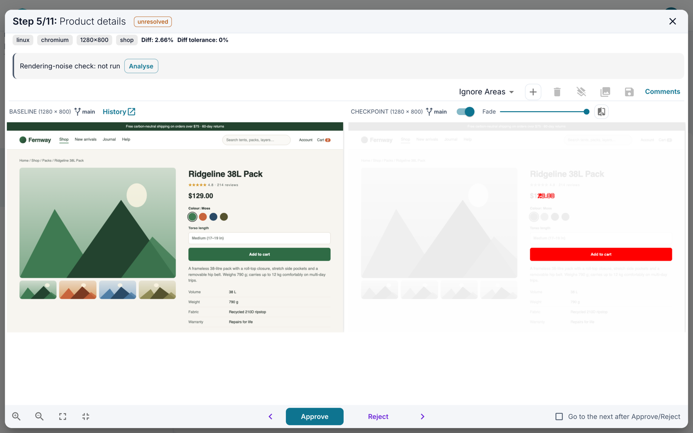
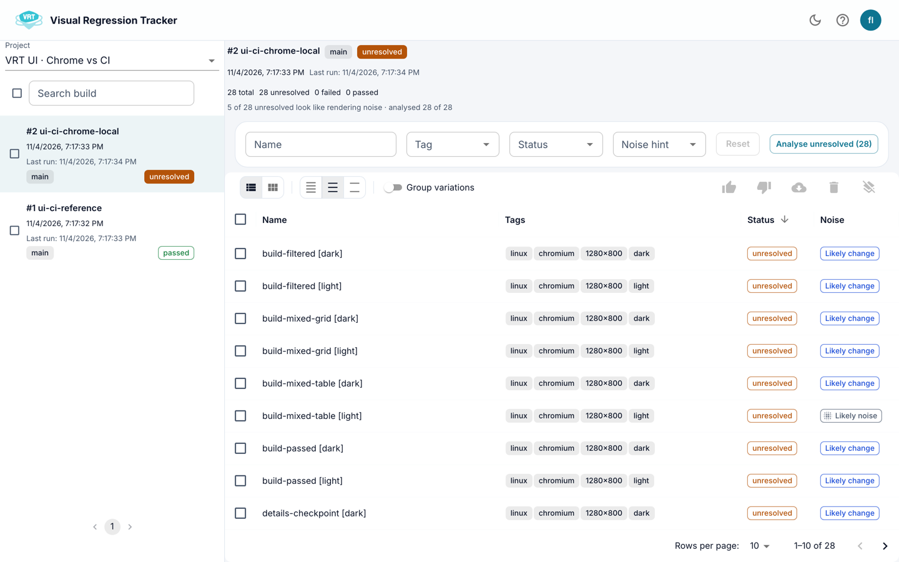
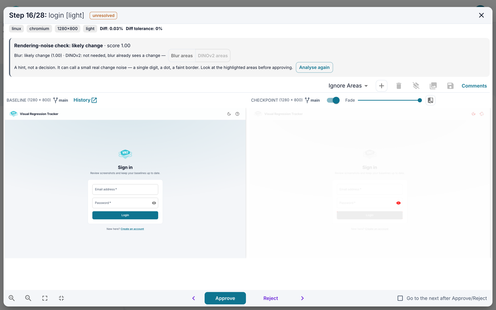
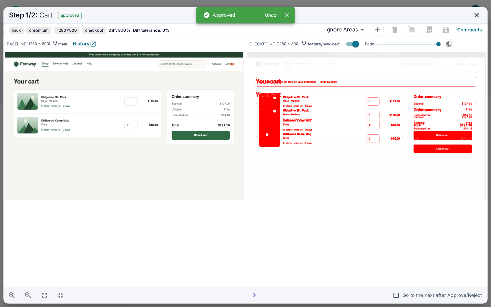
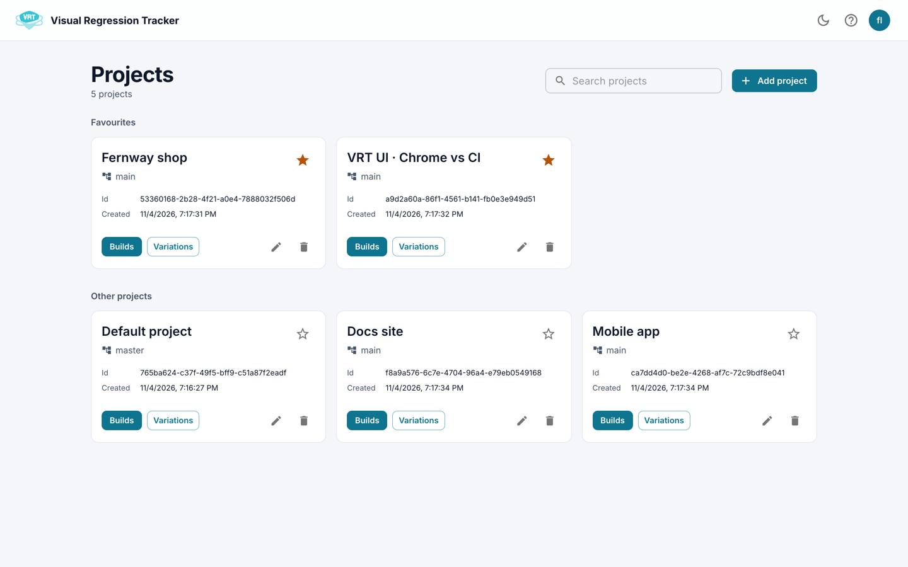
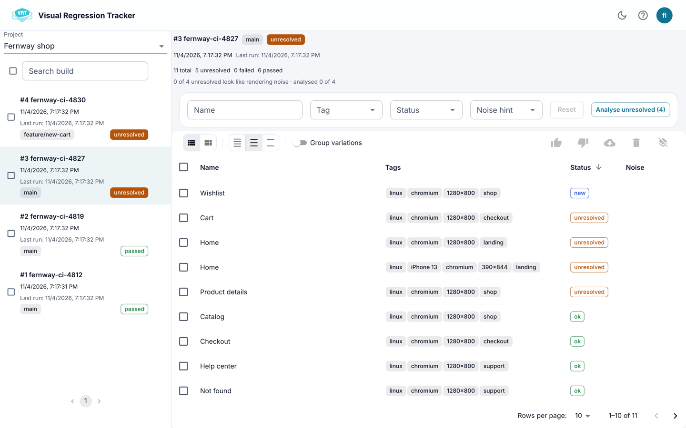

[](https://stand-with-ukraine.pp.ua)

<p align="center">
  
</p>

<h1 align="center">Visual Regression Tracker</h1>
<h3 align="center">Open-source, self-hosted visual testing. Send screenshots from any test suite, review what changed, keep baselines up to date.</h3>

<p align="center">
  <a href="#quick-start">Quick start</a> ·
  <a href="#whats-new-in-60">What's new in 6.0</a> ·
  <a href="#integrations">Integrations</a> ·
  <a href="https://t.me/visual_tracker">Telegram</a>
</p>

<picture>
  <source media="(prefers-color-scheme: dark)" srcset="./public/screenshots/diff-dark.png">
  
</picture>

## How it works

1. Your tests take screenshots, with any framework, on any platform, and send them to VRT through an agent, an SDK or the REST API.
2. VRT compares each screenshot with its accepted baseline for the same name, branch, browser, OS, viewport and device.
3. Unchanged screenshots pass. Changed ones wait for review in the UI: approve to make the new screenshot the baseline, reject to keep the old one.

Your CI gets the result immediately; your team reviews in one place.

## What's new in 6.0

### Review faster: changes first, rendering noise flagged

Different machines draw the same page a little differently: fonts, anti-aliasing, GPU. Those diffs used to bury the real ones. 6.0 checks unresolved runs on request and labels each one **Likely change** or **Likely noise**, so you can sort and filter the build and review the real changes first. It is a hint: it never approves anything, and it shows you the areas it judged.

<picture>
  <source media="(prefers-color-scheme: dark)" srcset="./public/screenshots/noise-build-dark.png">
  
</picture>

The check runs in two stages, set in the project's **Post-analysis** section. The blur stage runs on the API server. The optional DINOv2 stage (`--profile dinov2`) takes a second look at what blur calls noise, and catches faint icons and borders. On our benchmark of 120 real regressions under real rendering noise: blur alone keeps 92 of them as changes, both stages 102, with no false alarms on the noise.

<picture>
  <source media="(prefers-color-scheme: dark)" srcset="./public/screenshots/change-run-dark.png">
  
</picture>

### Undo a decision

Approved the wrong screenshot? Every approve and reject shows **Undo** for a few seconds. Undo of a feature-branch approval also brings back that branch's ignore areas and comment. When two people decide on the same run at once, only the decision that took effect gets Undo.

<picture>
  <source media="(prefers-color-scheme: dark)" srcset="./public/screenshots/undo-dark.png">
  
</picture>

### Find your projects

Star the projects you work on. Favourites and recently opened projects come first in the project list and in the project switcher, and both have search.

<picture>
  <source media="(prefers-color-scheme: dark)" srcset="./public/screenshots/projects-dark.png">
  
</picture>

### A new look, in light and dark

A redesigned UI on React 19 and MUI 9, with a dark theme that follows your system until you pick one.

<picture>
  <source media="(prefers-color-scheme: dark)" srcset="./public/screenshots/build-dark.png">
  
</picture>

### Secure by default

- No public signing key: the API does not start without your own `JWT_SECRET`.
- Live updates need a login and reach only the people looking at that project or build.
- The containers run as an unprivileged user, on PostgreSQL 18 and Node 26.
- Clear HTTP errors (`400`, `404`, `409`, `413`, `422`) instead of `200`/`500`.
- `REGISTRATION_ENABLED=false` turns off sign-up; SSO (OIDC) maps roles from your identity provider.

Upgrading from 5.x needs a database move to PostgreSQL 18 and a few settings: read the [6.0.0 release notes](https://github.com/Visual-Regression-Tracker/Visual-Regression-Tracker/releases/tag/6.0.0) before you start.

## Features

- **Works with any test framework**: Playwright, Cypress, CodeceptJS, Robot Framework, or your own through an SDK or the REST API.
- **Any platform**: web, mobile, desktop, PDF; anything you can screenshot.
- **Branches**: feature branches compare against their own baseline or the main branch's; merge a branch's baselines into another in one call.
- **Baseline history**: see every accepted version of a screenshot, who approved it and when.
- **Ignore areas**: mask dates, ads and other parts you cannot control, per screenshot or for a whole run.
- **Four comparators**, chosen per project:
  - [pixelmatch](https://github.com/mapbox/pixelmatch), pixel by pixel, the default;
  - [looks-same](https://github.com/gemini-testing/looks-same), perceptual;
  - [odiff](https://github.com/dmtrKovalenko/odiff), fast, with layout-shift detection;
  - VLM: pixelmatch plus a vision language model (Ollama, Gemini) that judges whether a human would notice the change ([details](https://github.com/Visual-Regression-Tracker/backend/blob/master/src/compare/libs/vlm/README.md)).
- **Rendering-noise hint**: see above.
- **Bulk review**: approve, reject or delete many runs, with a result for each one.
- **Users and roles**: admin, editor, guest; sign-in with a password, LDAP or SSO (OIDC).
- **Self-hosted**: Docker Compose, your database, your images (local disk or S3), nothing leaves your network.

<picture>
  <source media="(prefers-color-scheme: dark)" srcset="./public/screenshots/settings-dark.png">
  
</picture>

## Quick start

You need [Docker](https://docs.docker.com/get-docker/) with Compose v2.

```sh
curl -O https://raw.githubusercontent.com/Visual-Regression-Tracker/Visual-Regression-Tracker/master/docker-compose.yml
curl -O https://raw.githubusercontent.com/Visual-Regression-Tracker/Visual-Regression-Tracker/master/.env
sed -i.bak "s/^JWT_SECRET=.*/JWT_SECRET=$(openssl rand -hex 32)/" .env
mkdir -p imageUploads   # on Linux also: sudo chown -R 1000:1000 imageUploads
docker compose up -d
```

Open http://localhost:8080 and sign in as `visual-regression-tracker@example.com` / `123456`; the API key of that user is in `.env` (`DEFAULT_USER_API_KEY`). **Change both before anyone else can reach the server.**

With the rendering-noise check's DINOv2 stage: `docker compose --profile dinov2 up -d` and uncomment `DINOV2_URL` in `.env`.

To reach VRT from other machines, replace `localhost` in `REACT_APP_API_URL` and `APP_FRONTEND_URL` with a name or IP they can resolve.

<details>
<summary>Installation script (Linux, macOS, WSL)</summary>

```
curl https://raw.githubusercontent.com/Visual-Regression-Tracker/Visual-Regression-Tracker/master/vrt-install.sh -o vrt-install.sh
chmod a+x vrt-install.sh
./vrt-install.sh
```

```
Usage: ./vrt-install.sh

Arguments:
    -h | --help
    -a | --frontend-url <url>   Set the Front-end url. Default: http://localhost:8080
    -r | --backend-url <url>    Set the API url. Default: http://localhost:4200
    --jwt-secret <secret>       Set the JWT secret. Default: randomly generated
```

The script still checks for the standalone `docker-compose` (v1).
</details>

<details>
<summary>Upgrade from 5.x: the API runs as uid 1000</summary>

Since 6.0, the API and migration images run as uid 1000 instead of root, and dinov2 as `nobody` (65534). VRT 5.x ran as root, so on an existing install `./imageUploads` and any TLS files belong to root. Before the first start of 6.0, give them to uid 1000:

```
sudo chown -R 1000:1000 ./imageUploads ./ssl
```

Otherwise the API stops with `… is not writable by uid 1000 (EACCES): chown -R 1000:1000 …`. `vrt-install.sh` does this for `./imageUploads`. On macOS with Docker Desktop the chown is not needed. A new named Docker volume instead of the bind mount needs nothing. The UI keeps reading the same folder.
</details>

<details>
<summary>Upgrade the database from PostgreSQL 12</summary>

Since 6.0, `docker-compose.yml` runs PostgreSQL 18 and keeps its data in `./db/18/docker`. PostgreSQL 18 cannot read a database created by PostgreSQL 12 (VRT 5.x): it refuses to start on the old `./db` folder and leaves it as it is. Copy the database once with `pg_dump` and `pg_restore`, or with any tool you prefer. The images in `./imageUploads` are not part of the database and stay where they are. A database outside the bundled `postgres` service needs nothing.

In the folder with `docker-compose.yml` and `.env`, in a Linux, macOS or WSL shell (PowerShell's `>` and `<` do not pass the binary dump through):

1. Stop the UI and the API, so nothing is written after the dump, and dump the database:

```
docker compose stop ui api
docker compose exec -T postgres sh -c 'pg_dump -U "$POSTGRES_USER" -Fc "$POSTGRES_DB"' > vrt-pg12.dump
```

2. Move the old data aside with `docker compose down && mv db db-pg12`, then take the new `docker-compose.yml` and `.env` as in **Quick start** (carry over your settings, keep the old `docker-compose.yml` for a rollback).
3. Start the new database and restore the dump into it:

```
docker compose up -d --wait postgres
docker compose exec -T postgres sh -c 'pg_restore -U "$POSTGRES_USER" -d "$POSTGRES_DB" --exit-on-error' < vrt-pg12.dump
```

4. Start VRT: `docker compose up -d`. Once it works, delete `./db-pg12` (`sudo` may be needed) and `vrt-pg12.dump`.

To go back: `docker compose down`, `mv db db-new && mv db-pg12 db`, put back the old `docker-compose.yml` and run `docker compose up -d`.
</details>

<details>
<summary>Logs in Elasticsearch and Kibana</summary>

For admins who monitor VRT through Kibana; Elasticsearch keeps the logs and needs more memory and CPU.

1. Clone this repository and go to its folder. In `.env`, set `JWT_SECRET` (`openssl rand -hex 32`) and check `REACT_APP_API_URL`.
2. Start one of:
   - with a new Elastic stack: `docker compose -f docker-compose.yml -f docker-compose.elastic.logging.yml up`
   - with your organisation's Elasticsearch: set its hosts in `filebeat/config/filebeat.yml` and `ELASTIC_URL` in `.env`, then `docker compose -f docker-compose.yml -f docker-compose.logging.yml up`
3. If Filebeat stops with `config file ("filebeat.yml") must be owned by the user identifier (uid=0) or root`, follow the [Elastic instructions](https://www.elastic.co/guide/en/beats/libbeat/current/config-file-permissions.html) and start again.
</details>

## Integrations

| | Package | 6.0 server |
|---|---|---|
| Playwright | [agent-playwright](https://www.npmjs.com/package/@visual-regression-tracker/agent-playwright) | 5.5.0+ |
| Cypress | [agent-cypress](https://www.npmjs.com/package/@visual-regression-tracker/agent-cypress) | 5.9.0+ |
| CodeceptJS | [agent-codeceptjs](https://github.com/Visual-Regression-Tracker/agent-codeceptjs) | |
| Robot Framework | [robotframework-VRTLibrary](https://github.com/NiceProjectPoland/robotframework-VRTLibrary) (community) | |
| JavaScript / TypeScript | [sdk-js](https://www.npmjs.com/package/@visual-regression-tracker/sdk-js) | 5.9.0+ |
| Java | [sdk-java](https://github.com/Visual-Regression-Tracker/sdk-java) | 5.6.1+ |
| Python | [sdk-python](https://github.com/Visual-Regression-Tracker/sdk-python) | 5.1.0+ |
| .NET | [sdk-dotnet](https://github.com/Visual-Regression-Tracker/sdk-dotnet) | 5.1.0+ |
| Anything else | REST API, Swagger at `http://localhost:4200/api` | |

Examples: [JavaScript](https://github.com/Visual-Regression-Tracker/vrt-examples-js) · [Java](https://github.com/Visual-Regression-Tracker/examples-java) · [Python](https://github.com/Visual-Regression-Tracker/examples-python) · [.NET](https://github.com/Visual-Regression-Tracker/examples-dotnet)

Guides: [Cypress](https://github.com/Visual-Regression-Tracker/Visual-Regression-Tracker/wiki/Getting-started-with-Cypress) · [Playwright](https://github.com/Visual-Regression-Tracker/Visual-Regression-Tracker/wiki/Getting-started-with-Playwright) · [Storybook](https://github.com/Visual-Regression-Tracker/Visual-Regression-Tracker/wiki/Storybook) · [Selenide](https://github.com/Visual-Regression-Tracker/Visual-Regression-Tracker/wiki/Getting-started-with-Selenide) · [Jenkins](https://github.com/Visual-Regression-Tracker/Visual-Regression-Tracker/wiki/How-to-publish-VRT-result-in-jenkins) · [Images and PDF from a folder](https://github.com/Visual-Regression-Tracker/examples-java/tree/master/standalone-from-folder-maven) · [Set up on a remote machine (video)](https://www.youtube.com/watch?v=cPsHeKnqL2M)

## Glossary

- **Project**: builds and test variations of one product.
- **Build**: the test runs of one CI run.
- **Test run**: one screenshot compared with its baseline.
- **Test variation**: the history of baselines for one name + branch + OS + browser + viewport + device.
- **Baseline**: the accepted screenshot that the next run is compared with.

## Contributing

Try it, open issues with ideas, questions and bugs, and tell us what you think in the [1-minute survey](https://forms.gle/DidGSodojQ4Qn4is6) or on [Telegram](https://t.me/visual_tracker). SDKs for more languages and agents for more frameworks are welcome.

## Contributors ✨

Thanks goes to these wonderful people ([emoji key](https://allcontributors.org/docs/en/emoji-key)):

<!-- ALL-CONTRIBUTORS-LIST:START - Do not remove or modify this section -->
<!-- prettier-ignore-start -->
<!-- markdownlint-disable -->
<table>
  <tbody>
    <tr>
      <td align="center" valign="top" width="14.28%"><a href="https://www.linkedin.com/in/pavel-strunkin-310b776a/"><br /><sub><b>Pavel Strunkin</b></sub></a><br /><a href="https://github.com/Visual-Regression-Tracker/Visual-Regression-Tracker/commits?author=pashidlos" title="Code">💻</a> <a href="#business-pashidlos" title="Business development">💼</a> <a href="#ideas-pashidlos" title="Ideas, Planning, & Feedback">🤔</a> <a href="#plugin-pashidlos" title="Plugin/utility libraries">🔌</a></td>
      <td align="center" valign="top" width="14.28%"><a href="https://github.com/dcrowe"><br /><sub><b>Daniel Crowe</b></sub></a><br /><a href="#plugin-dcrowe" title="Plugin/utility libraries">🔌</a> <a href="https://github.com/Visual-Regression-Tracker/Visual-Regression-Tracker/pulls?q=is%3Apr+reviewed-by%3Adcrowe" title="Reviewed Pull Requests">👀</a></td>
      <td align="center" valign="top" width="14.28%"><a href="https://github.com/suratdas"><br /><sub><b>Surat Das</b></sub></a><br /><a href="https://github.com/Visual-Regression-Tracker/Visual-Regression-Tracker/commits?author=suratdas" title="Code">💻</a> <a href="#plugin-suratdas" title="Plugin/utility libraries">🔌</a></td>
      <td align="center" valign="top" width="14.28%"><a href="https://alexromanov.github.io/"><br /><sub><b>Oleksandr Romanov</b></sub></a><br /><a href="#plugin-alexromanov" title="Plugin/utility libraries">🔌</a></td>
      <td align="center" valign="top" width="14.28%"><a href="https://github.com/TerentyevDenis"><br /><sub><b>Terentev Denis</b></sub></a><br /><a href="#plugin-TerentyevDenis" title="Plugin/utility libraries">🔌</a></td>
      <td align="center" valign="top" width="14.28%"><a href="https://github.com/JustSittinHere"><br /><sub><b>JustSittinHere</b></sub></a><br /><a href="#plugin-JustSittinHere" title="Plugin/utility libraries">🔌</a></td>
      <td align="center" valign="top" width="14.28%"><a href="https://github.com/dekaravanhoc"><br /><sub><b>Dekara VanHoc</b></sub></a><br /><a href="#plugin-dekaravanhoc" title="Plugin/utility libraries">🔌</a></td>
    </tr>
    <tr>
      <td align="center" valign="top" width="14.28%"><a href="http://frabbit.ru"><br /><sub><b>maddocnc</b></sub></a><br /><a href="https://github.com/Visual-Regression-Tracker/Visual-Regression-Tracker/commits?author=maddocnc" title="Code">💻</a></td>
      <td align="center" valign="top" width="14.28%"><a href="https://github.com/AaronChelvan"><br /><sub><b>Aaron Chelvan</b></sub></a><br /><a href="https://github.com/Visual-Regression-Tracker/Visual-Regression-Tracker/commits?author=AaronChelvan" title="Code">💻</a> <a href="https://github.com/Visual-Regression-Tracker/Visual-Regression-Tracker/commits?author=AaronChelvan" title="Documentation">📖</a></td>
      <td align="center" valign="top" width="14.28%"><a href="https://github.com/marcm-qa"><br /><sub><b>marcm-qa</b></sub></a><br /><a href="#plugin-marcm-qa" title="Plugin/utility libraries">🔌</a></td>
      <td align="center" valign="top" width="14.28%"><a href="https://github.com/Eduard-iCH"><br /><sub><b>Eduard-iCH</b></sub></a><br /><a href="#plugin-Eduard-iCH" title="Plugin/utility libraries">🔌</a></td>
      <td align="center" valign="top" width="14.28%"><a href="http://dev.flauschig.ch"><br /><sub><b>Roman</b></sub></a><br /><a href="https://github.com/Visual-Regression-Tracker/Visual-Regression-Tracker/commits?author=Roemer" title="Code">💻</a></td>
      <td align="center" valign="top" width="14.28%"><a href="http://dimitriharding.com"><br /><sub><b>Dimitri Harding</b></sub></a><br /><a href="https://github.com/Visual-Regression-Tracker/Visual-Regression-Tracker/commits?author=dimitriharding" title="Code">💻</a></td>
      <td align="center" valign="top" width="14.28%"><a href="https://github.com/vkostromin94"><br /><sub><b>vkostromin94</b></sub></a><br /><a href="#plugin-vkostromin94" title="Plugin/utility libraries">🔌</a></td>
    </tr>
    <tr>
      <td align="center" valign="top" width="14.28%"><a href="https://github.com/bmbferreira"><br /><sub><b>Bruno Ferreira</b></sub></a><br /><a href="https://github.com/Visual-Regression-Tracker/Visual-Regression-Tracker/commits?author=bmbferreira" title="Code">💻</a></td>
      <td align="center" valign="top" width="14.28%"><a href="https://github.com/nicerloop"><br /><sub><b>Loïc PÉRON</b></sub></a><br /><a href="https://github.com/Visual-Regression-Tracker/Visual-Regression-Tracker/commits?author=nicerloop" title="Code">💻</a> <a href="#plugin-nicerloop" title="Plugin/utility libraries">🔌</a></td>
      <td align="center" valign="top" width="14.28%"><a href="http://htts://vk.com/wsbaser"><br /><sub><b>Alexey Volkov</b></sub></a><br /><a href="#plugin-wsbaser" title="Plugin/utility libraries">🔌</a> <a href="https://github.com/Visual-Regression-Tracker/Visual-Regression-Tracker/commits?author=wsbaser" title="Code">💻</a></td>
      <td align="center" valign="top" width="14.28%"><a href="http://legori.ru"><br /><sub><b>Egor Lipskiy</b></sub></a><br /><a href="#plugin-elipskiy" title="Plugin/utility libraries">🔌</a></td>
      <td align="center" valign="top" width="14.28%"><a href="https://github.com/nitschSB"><br /><sub><b>nitschSB</b></sub></a><br /><a href="https://github.com/Visual-Regression-Tracker/Visual-Regression-Tracker/commits?author=nitschSB" title="Code">💻</a></td>
      <td align="center" valign="top" width="14.28%"><a href="https://github.com/polyvisual"><br /><sub><b>polyvisual</b></sub></a><br /><a href="https://github.com/Visual-Regression-Tracker/Visual-Regression-Tracker/commits?author=polyvisual" title="Code">💻</a></td>
      <td align="center" valign="top" width="14.28%"><a href="https://paazmaya.fi"><br /><sub><b>Juga Paazmaya</b></sub></a><br /><a href="#plugin-paazmaya" title="Plugin/utility libraries">🔌</a> <a href="https://github.com/Visual-Regression-Tracker/Visual-Regression-Tracker/commits?author=paazmaya" title="Code">💻</a></td>
    </tr>
    <tr>
      <td align="center" valign="top" width="14.28%"><a href="https://github.com/s-weigand"><br /><sub><b>Sebastian Weigand</b></sub></a><br /><a href="https://github.com/Visual-Regression-Tracker/Visual-Regression-Tracker/commits?author=s-weigand" title="Code">💻</a></td>
      <td align="center" valign="top" width="14.28%"><a href="https://github.com/oleg-rd"><br /><sub><b>Oleg Ridchenko</b></sub></a><br /><a href="#plugin-oleg-rd" title="Plugin/utility libraries">🔌</a></td>
      <td align="center" valign="top" width="14.28%"><a href="https://github.com/groinder"><br /><sub><b>Krzysztof Przybylski</b></sub></a><br /><a href="https://github.com/Visual-Regression-Tracker/Visual-Regression-Tracker/commits?author=groinder" title="Code">💻</a></td>
      <td align="center" valign="top" width="14.28%"><a href="https://github.com/adriannieto"><br /><sub><b>Adrian N.</b></sub></a><br /><a href="https://github.com/Visual-Regression-Tracker/Visual-Regression-Tracker/commits?author=adriannieto" title="Code">💻</a></td>
      <td align="center" valign="top" width="14.28%"><a href="https://github.com/nGervasyuk"><br /><sub><b>Nikolay Gervasyuk</b></sub></a><br /><a href="https://github.com/Visual-Regression-Tracker/Visual-Regression-Tracker/commits?author=nGervasyuk" title="Code">💻</a></td>
      <td align="center" valign="top" width="14.28%"><a href="https://adabru.de"><br /><sub><b>Adam Brunnmeier</b></sub></a><br /><a href="https://github.com/Visual-Regression-Tracker/Visual-Regression-Tracker/commits?author=adabru" title="Code">💻</a></td>
      <td align="center" valign="top" width="14.28%"><a href="https://github.com/okstryzhak"><br /><sub><b>Oksana Stryzhak</b></sub></a><br /><a href="https://github.com/Visual-Regression-Tracker/Visual-Regression-Tracker/commits?author=okstryzhak" title="Code">💻</a></td>
    </tr>
    <tr>
      <td align="center" valign="top" width="14.28%"><a href="https://bevyl.ai"><br /><sub><b>Noah</b></sub></a><br /><a href="https://github.com/Visual-Regression-Tracker/Visual-Regression-Tracker/commits?author=Octember" title="Code">💻</a></td>
      <td align="center" valign="top" width="14.28%"><a href="https://github.com/mokhtardziri"><br /><sub><b>mokhtardziri</b></sub></a><br /><a href="https://github.com/Visual-Regression-Tracker/Visual-Regression-Tracker/commits?author=mokhtardziri" title="Code">💻</a></td>
      <td align="center" valign="top" width="14.28%"><a href="https://github.com/Roman1137"><br /><sub><b>Roman1137</b></sub></a><br /><a href="#plugin-Roman1137" title="Plugin/utility libraries">🔌</a> <a href="https://github.com/Visual-Regression-Tracker/Visual-Regression-Tracker/commits?author=Roman1137" title="Documentation">📖</a></td>
      <td align="center" valign="top" width="14.28%"><a href="https://github.com/tchiaspko"><br /><sub><b>Tony Chia</b></sub></a><br /><a href="https://github.com/Visual-Regression-Tracker/Visual-Regression-Tracker/commits?author=tchiaspko" title="Code">💻</a> <a href="#example-tchiaspko" title="Examples">💡</a></td>
      <td align="center" valign="top" width="14.28%"><a href="https://github.com/dortizesquivel"><br /><sub><b>dortizesquivel</b></sub></a><br /><a href="#infra-dortizesquivel" title="Infrastructure (Hosting, Build-Tools, etc)">🚇</a></td>
      <td align="center" valign="top" width="14.28%"><a href="https://www.linkedin.com/in/shankysharma/"><br /><sub><b>Shanky Sharma</b></sub></a><br /><a href="https://github.com/Visual-Regression-Tracker/Visual-Regression-Tracker/commits?author=shankybnl" title="Code">💻</a></td>
      <td align="center" valign="top" width="14.28%"><a href="https://github.com/rschmidt-webit"><br /><sub><b>rschmidt-webit</b></sub></a><br /><a href="#example-rschmidt-webit" title="Examples">💡</a></td>
    </tr>
    <tr>
      <td align="center" valign="top" width="14.28%"><a href="https://github.com/stp4k"><br /><sub><b>Stepan Churakov</b></sub></a><br /><a href="#example-stp4k" title="Examples">💡</a></td>
    </tr>
  </tbody>
</table>

<!-- markdownlint-restore -->
<!-- prettier-ignore-end -->

<!-- ALL-CONTRIBUTORS-LIST:END -->
This project follows the [all-contributors](https://github.com/all-contributors/all-contributors) specification. Contributions of any kind welcome!
