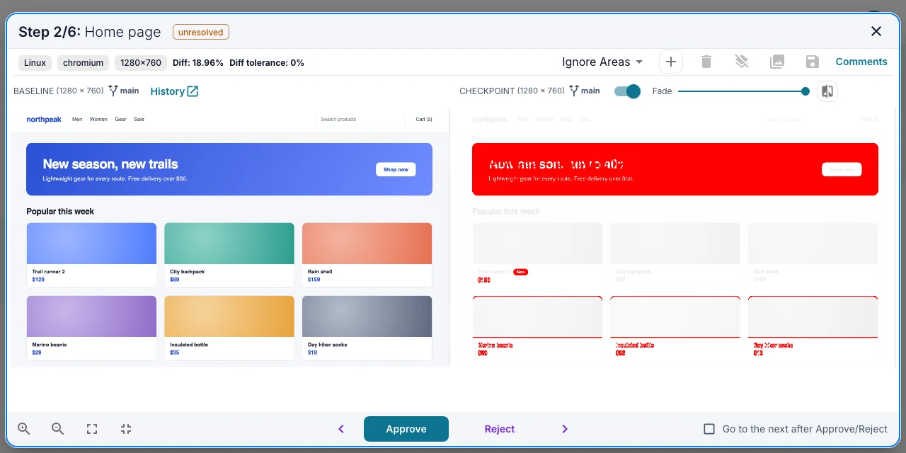
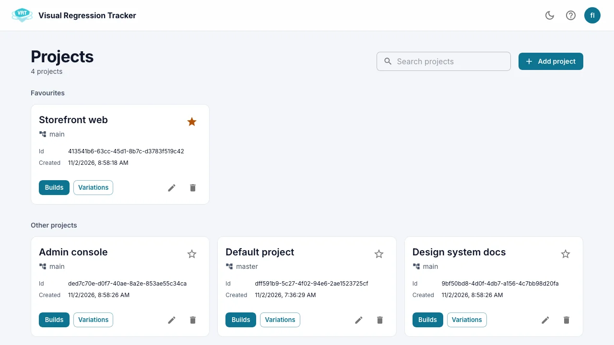
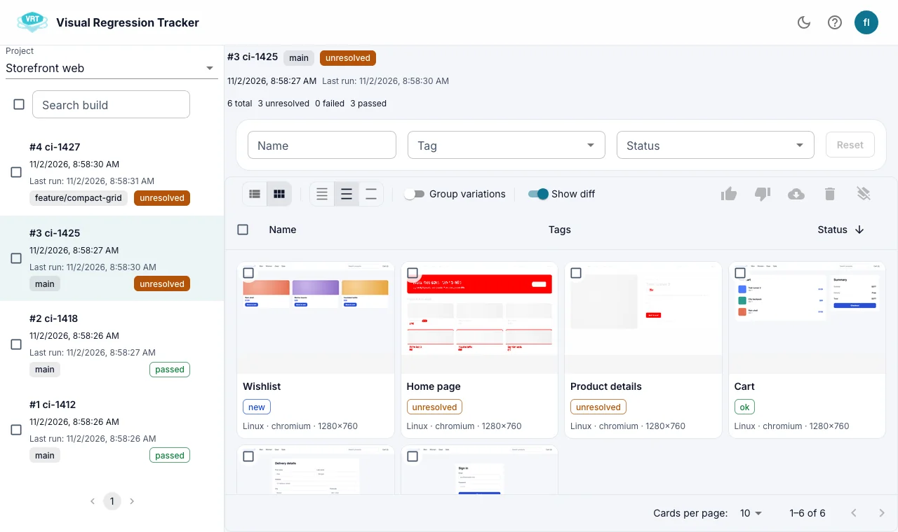
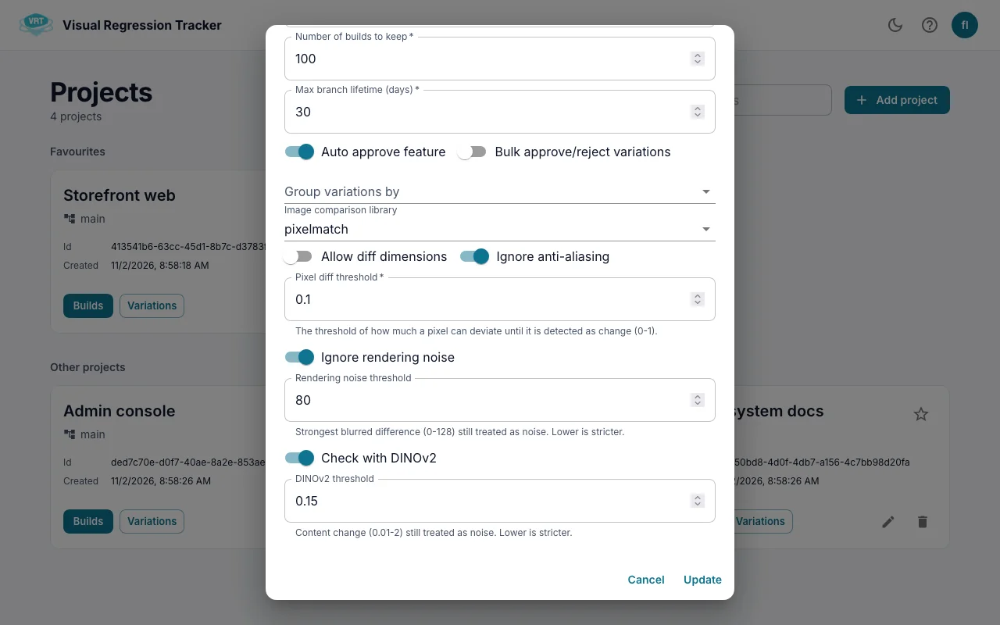

[](https://stand-with-ukraine.pp.ua)

<p align="center">
  
</p>

<h1 align="center">Visual Regression Tracker</h1>

<p align="center">
  Open-source, self-hosted visual testing: send screenshots from your tests, review what changed, approve the new baseline.
</p>

<p align="center">
  <a href="https://github.com/Visual-Regression-Tracker/Visual-Regression-Tracker/releases/latest"></a>
  <a href="https://hub.docker.com/r/visualregressiontracker/api"></a>
  <a href="./LICENSE"></a>
  <a href="https://t.me/visual_tracker"></a>
</p>

<picture>
  <source media="(prefers-color-scheme: dark)" srcset="./public/readme/diff-dark.webp">
  
</picture>

## How it works

Your test suite takes a screenshot and sends it to VRT with a name and tags (browser, OS, viewport, device). VRT compares it with the approved baseline for the same tags and branch and returns the result straight away, so the test can pass or fail. Changed screenshots wait in the UI until someone approves the new baseline or rejects the change.

- **Works with any framework**: agents for Playwright, Cypress, CodeceptJS and Robot Framework, SDKs for JavaScript, Java, Python and .NET, or plain REST.
- **Any platform**: web, mobile, desktop, as long as you can take a screenshot.
- **Branches**: feature branches get their own baselines and fall back to the main branch; merge them when the branch lands.
- **Baseline history**: see how a screenshot changed over time and who approved it.
- **Ignore areas**: mask dates, ads and other regions you do not control.
- **Choice of comparison engine** per project, plus an optional rendering-noise filter.
- **Self-hosted**: everything runs in Docker; images stay on your disk or in your S3 bucket.
- **Sign-in**: local users, LDAP or OpenID Connect (Keycloak, Entra ID, Okta, Google, ...), with admin, editor and guest roles.
- **PDFs too**: a standalone jar compares PDFs and images from a folder.

Take the [1-minute survey](https://forms.gle/DidGSodojQ4Qn4is6) to help us prioritise, or join the [Telegram group](https://t.me/visual_tracker).

## New in 6.0

- **Undo**: take back an approve or reject from the notification that follows it.
- **Favourite projects** stay at the top of the project list.
- **Rendering-noise filter**: anti-aliasing and sub-pixel shifts no longer fail a run. An optional DINOv2 service takes a second look at what the filter lets through.
- **Bulk actions report per run**: a partly failed bulk approve, reject or delete says which runs failed.
- **Dark theme** that follows your system or the toggle in the header; MUI 7 and React 19 underneath.
- **Operations**: `REGISTRATION_ENABLED` to hide sign-up, authenticated and scoped live updates, Redis for more than one API instance, upload and image-size limits, and images for `linux/amd64` and `linux/arm64`.
- **API**: errors are proper `4xx` codes instead of `200`/`500`.

See the [6.0.0 release notes](https://github.com/Visual-Regression-Tracker/Visual-Regression-Tracker/releases/tag/6.0.0) for breaking changes and the upgrade steps.

## A quick tour

### Projects

Projects hold builds and baselines. Star the ones you work on.

<picture>
  <source media="(prefers-color-scheme: dark)" srcset="./public/readme/projects-dark.webp">
  
</picture>

### Builds

Each CI run is a build. Filter its test runs by name, tag or status, switch between a table and a thumbnail grid with the diff on top, and approve or reject several runs at once.

<picture>
  <source media="(prefers-color-scheme: dark)" srcset="./public/readme/build-dark.webp">
  
</picture>

### Comparison

Open a run to see the baseline and the new screenshot side by side or faded into each other, zoom in, add ignore areas, leave a comment, and approve or reject. The hero image at the top of this page is this view.

### Project settings and the noise filter

Pick the comparison engine and its thresholds per project. Turn on **Ignore rendering noise** to pass runs whose only differences are anti-aliasing or sub-pixel shifts, and **Check with DINOv2** to have a vision model confirm them.

<picture>
  <source media="(prefers-color-scheme: dark)" srcset="./public/readme/settings-dark.webp">
  
</picture>

## Comparison engines

| Engine | Good for |
|---|---|
| [pixelmatch](https://github.com/mapbox/pixelmatch) (default) | Fast pixel-by-pixel comparison: catches every changed pixel. |
| [looks-same](https://github.com/gemini-testing/looks-same) | Perceptual comparison that tolerates small rendering differences. |
| [odiff](https://github.com/dmtrKovalenko/odiff) | Fast diffing with anti-aliasing detection and layout-change checks. |
| [VLM](https://github.com/Visual-Regression-Tracker/backend/blob/master/src/compare/libs/vlm/README.md) | pixelmatch first, then a vision language model (Ollama or Gemini) decides whether a person would notice the change. |

The rendering-noise filter works with every engine. Its DINOv2 check needs the optional `dinov2` service ([details](https://github.com/Visual-Regression-Tracker/backend/blob/master/dinov2/README.md)).

## Glossary

- **Project**: a set of builds and test variations.
- **Build**: the test runs of one CI run.
- **Test run**: one screenshot compared with its baseline.
- **Test variation**: the baselines of one screenshot over time, keyed by name, branch, OS, browser, viewport, device and custom tags.
- **Baseline**: the approved image a new screenshot is compared with.

## Quick start

You need [Docker](https://docs.docker.com/get-docker/) with Compose v2.

1. Download the compose file and the example settings:

   ```sh
   curl -O https://raw.githubusercontent.com/Visual-Regression-Tracker/Visual-Regression-Tracker/master/docker-compose.yml
   curl -O https://raw.githubusercontent.com/Visual-Regression-Tracker/Visual-Regression-Tracker/master/.env
   ```

2. Edit `.env`:
   - set `JWT_SECRET` to a long random value (for example `openssl rand -hex 32`);
   - change `DEFAULT_USER_PASSWORD` and `DEFAULT_USER_API_KEY`, or leave them empty to have random ones generated and shown once in `docker compose logs migration`;
   - if other machines will open VRT, replace `localhost` in `REACT_APP_API_URL` and `APP_FRONTEND_URL` with a name they can resolve.

3. Start it:

   ```sh
   docker compose up -d
   ```

4. Open http://localhost:8080 and sign in with `DEFAULT_USER_EMAIL` and `DEFAULT_USER_PASSWORD`. The API and its Swagger UI are at http://localhost:4200/api.

To use the DINOv2 check of the noise filter, uncomment `DINOV2_URL=http://dinov2:8000` in `.env` and start the stack with its profile:

```sh
docker compose --profile dinov2 up -d
```

<details>
<summary>Install script (Linux, macOS, WSL)</summary>

The script downloads the same two files, generates a JWT secret, applies the URLs you pass and starts the stack. It calls the standalone `docker-compose` command.

```sh
curl https://raw.githubusercontent.com/Visual-Regression-Tracker/Visual-Regression-Tracker/master/vrt-install.sh -o vrt-install.sh
chmod a+x vrt-install.sh
./vrt-install.sh
```

```
Usage: ./vrt-install.sh

Arguments:
    -h | --help
    -a | --frontend-url <url>   Set the Front-end url. Default: http://localhost:8080
    -r | --backend-url <url>    Set the API url. Default: http://localhost:4200
    --jwt-secret <secret>       Set the JWT secret. Default: randomly generated
```

</details>

<details>
<summary>Logs in Elasticsearch and Kibana</summary>

For admins who want to read VRT logs in Kibana. Elasticsearch needs more memory and CPU; consult its documentation if it reports errors. Running as root avoids file ownership problems with Filebeat.

1. Clone this repository and adjust `.env` as in the quick start.
2. Start the stack with one of the logging overlays:
   - with a new Elastic stack:

     ```sh
     docker compose -f docker-compose.yml -f docker-compose.elastic.logging.yml up -d
     ```

   - with an Elasticsearch server you already run: set `hosts` in `filebeat/config/filebeat.yml` to it, then

     ```sh
     docker compose -f docker-compose.yml -f docker-compose.logging.yml up -d
     ```

3. If Filebeat stops with `config file ("filebeat.yml") must be owned by the user identifier (uid=0) or root`, fix the permissions as described in the [Beats documentation](https://www.elastic.co/guide/en/beats/libbeat/current/config-file-permissions.html) and start again.

</details>

## Upgrading from 5.x

Back up the database, take `docker-compose.yml` and `.env` from this release (keep your values; new settings are commented out with their defaults), then:

```sh
docker compose pull
docker compose up -d
```

Upgrade the UI and the API together: UI 6.0 needs API 6.0. The `migration` service updates the database before the API starts. The [release notes](https://github.com/Visual-Regression-Tracker/Visual-Regression-Tracker/releases/tag/6.0.0) cover the breaking changes, the API key rotation advised after 5.7.0, and how to switch on authenticated live updates.

## Configuration

All settings live in `.env`. The common ones:

| Variable | Default | What it does |
|---|---|---|
| `VRT_UI_VERSION`, `VRT_API_VERSION`, `VRT_MIGRATION_VERSION`, `VRT_DINOV2_VERSION` | this release | Image tags. |
| `PORT`, `APP_PORT` | `8080`, `4200` | Host ports of the UI and the API. |
| `REACT_APP_API_URL`, `APP_FRONTEND_URL` | `http://localhost:4200`, `http://localhost:8080` | How the browser reaches the API, and the UI address used in the links the API returns. |
| `JWT_SECRET` | sample value | Signs login tokens. Required; replace the sample. |
| `JWT_LIFE_TIME` | `1d` | How long a login lasts. |
| `DEFAULT_USER_EMAIL`, `DEFAULT_USER_PASSWORD`, `DEFAULT_USER_API_KEY` | sample values | The first admin, created by the `migration` service while no admin exists. |
| `POSTGRES_USER`, `POSTGRES_PASSWORD`, `POSTGRES_DB`, `POSTGRES_PORT` | `postgres`, sample, `vrt_db`, `5432` | Database. |
| `REGISTRATION_ENABLED` | `true` | `false` hides sign-up; an admin, LDAP or OIDC creates users. |
| `STATIC_SERVICE`, `AWS_*` | local disk | `s3` stores images in an S3 bucket. |
| `LDAP_*` | off | Sign in with LDAP. |
| `OIDC_*`, `REACT_APP_OIDC_AUTO_REDIRECT` | off | Single sign-on with OpenID Connect. Takes precedence over LDAP. |
| `BODY_PARSER_JSON_LIMIT` | `5mb` | Largest JSON body, that is a base64 screenshot. |
| `MULTIPART_FILE_SIZE_LIMIT` | `104857600` | Largest multipart upload, in bytes. |
| `MAX_IMAGE_PIXELS` | `100000000` | Larger screenshots are refused with `422`. |
| `WS_AUTH_REQUIRED` | `false` | `true` refuses live-update connections without a login token. |
| `WS_BROADCAST` | `true` | `false` sends live updates only to clients viewing that project or build. |
| `REDIS_URL` | unset | Shares live updates between several API instances. |
| `DINOV2_URL`, `DINOV2_TIMEOUT_MS` | unset, `60000` | The DINOv2 service for the noise filter. |
| `OLLAMA_BASE_URL` | `http://host.docker.internal:11434` | Ollama for the VLM engine. |
| `DIFF_WORKERS_COUNT`, `DIFF_QUEUE_LIMIT`, `DIFF_WORKER_MAX_HEAP_MB` | CPUs − 1, `256`, `512` | Diff worker threads, the queue before the API answers `503`, and each worker's heap in MB. |
| `SERVER_TIMEOUT`, `SERVER_HEADERS_TIMEOUT`, `SERVER_KEEP_ALIVE_TIMEOUT` | Node defaults | HTTP server timeouts in ms. |
| `LOG_LEVEL` | all levels | Comma-separated Nest log levels, such as `log,error,warn`. |

The [backend README](https://github.com/Visual-Regression-Tracker/backend/blob/master/README.md) describes every setting in detail.

## Integrations

Add visual assertions to the tests you already have.

**Agents**

- [Playwright](https://www.npmjs.com/package/@visual-regression-tracker/agent-playwright)
- [Cypress](https://www.npmjs.com/package/@visual-regression-tracker/agent-cypress)
- [CodeceptJS](https://github.com/Visual-Regression-Tracker/agent-codeceptjs)
- [Robot Framework](https://github.com/NiceProjectPoland/robotframework-VRTLibrary)

**Core SDKs**, thin wrappers over the REST API

- [JavaScript](https://www.npmjs.com/package/@visual-regression-tracker/sdk-js)
- [Java](https://github.com/Visual-Regression-Tracker/sdk-java)
- [Python](https://github.com/Visual-Regression-Tracker/sdk-python)
- [.NET](https://github.com/Visual-Regression-Tracker/sdk-dotnet)

**Guides**

- [Cypress](https://github.com/Visual-Regression-Tracker/Visual-Regression-Tracker/wiki/Getting-started-with-Cypress)
- [Playwright](https://github.com/Visual-Regression-Tracker/Visual-Regression-Tracker/wiki/Getting-started-with-Playwright)
- [Storybook](https://github.com/Visual-Regression-Tracker/Visual-Regression-Tracker/wiki/Storybook)
- [Selenide (Java)](https://github.com/Visual-Regression-Tracker/Visual-Regression-Tracker/wiki/Getting-started-with-Selenide)
- [Publishing VRT results in Jenkins (Java SDK)](https://github.com/Visual-Regression-Tracker/Visual-Regression-Tracker/wiki/How-to-publish-VRT-result-in-jenkins)
- [Comparing images and PDFs from the command line](https://github.com/Visual-Regression-Tracker/examples-java/tree/master/standalone-from-folder-maven)
- Video: [setting up VRT on a remote machine over SSH](https://www.youtube.com/watch?v=cPsHeKnqL2M)

**Examples**: [JavaScript](https://github.com/Visual-Regression-Tracker/vrt-examples-js) · [Java](https://github.com/Visual-Regression-Tracker/examples-java) · [Python](https://github.com/Visual-Regression-Tracker/examples-python) · [.NET](https://github.com/Visual-Regression-Tracker/examples-dotnet)

## Contributing

Try it and open issues with ideas, questions and bugs. SDKs for more languages and agents for more test frameworks are especially welcome. The code lives in [backend](https://github.com/Visual-Regression-Tracker/backend) and [frontend](https://github.com/Visual-Regression-Tracker/frontend); this repository holds the Docker setup and the docs.

## Contributors ✨

Thanks goes to these wonderful people ([emoji key](https://allcontributors.org/docs/en/emoji-key)):

<!-- ALL-CONTRIBUTORS-LIST:START - Do not remove or modify this section -->
<!-- prettier-ignore-start -->
<!-- markdownlint-disable -->
<table>
  <tbody>
    <tr>
      <td align="center" valign="top" width="14.28%"><a href="https://www.linkedin.com/in/pavel-strunkin-310b776a/"><br /><sub><b>Pavel Strunkin</b></sub></a><br /><a href="https://github.com/Visual-Regression-Tracker/Visual-Regression-Tracker/commits?author=pashidlos" title="Code">💻</a> <a href="#business-pashidlos" title="Business development">💼</a> <a href="#ideas-pashidlos" title="Ideas, Planning, & Feedback">🤔</a> <a href="#plugin-pashidlos" title="Plugin/utility libraries">🔌</a></td>
      <td align="center" valign="top" width="14.28%"><a href="https://github.com/dcrowe"><br /><sub><b>Daniel Crowe</b></sub></a><br /><a href="#plugin-dcrowe" title="Plugin/utility libraries">🔌</a> <a href="https://github.com/Visual-Regression-Tracker/Visual-Regression-Tracker/pulls?q=is%3Apr+reviewed-by%3Adcrowe" title="Reviewed Pull Requests">👀</a></td>
      <td align="center" valign="top" width="14.28%"><a href="https://github.com/suratdas"><br /><sub><b>Surat Das</b></sub></a><br /><a href="https://github.com/Visual-Regression-Tracker/Visual-Regression-Tracker/commits?author=suratdas" title="Code">💻</a> <a href="#plugin-suratdas" title="Plugin/utility libraries">🔌</a></td>
      <td align="center" valign="top" width="14.28%"><a href="https://alexromanov.github.io/"><br /><sub><b>Oleksandr Romanov</b></sub></a><br /><a href="#plugin-alexromanov" title="Plugin/utility libraries">🔌</a></td>
      <td align="center" valign="top" width="14.28%"><a href="https://github.com/TerentyevDenis"><br /><sub><b>Terentev Denis</b></sub></a><br /><a href="#plugin-TerentyevDenis" title="Plugin/utility libraries">🔌</a></td>
      <td align="center" valign="top" width="14.28%"><a href="https://github.com/JustSittinHere"><br /><sub><b>JustSittinHere</b></sub></a><br /><a href="#plugin-JustSittinHere" title="Plugin/utility libraries">🔌</a></td>
      <td align="center" valign="top" width="14.28%"><a href="https://github.com/dekaravanhoc"><br /><sub><b>Dekara VanHoc</b></sub></a><br /><a href="#plugin-dekaravanhoc" title="Plugin/utility libraries">🔌</a></td>
    </tr>
    <tr>
      <td align="center" valign="top" width="14.28%"><a href="http://frabbit.ru"><br /><sub><b>maddocnc</b></sub></a><br /><a href="https://github.com/Visual-Regression-Tracker/Visual-Regression-Tracker/commits?author=maddocnc" title="Code">💻</a></td>
      <td align="center" valign="top" width="14.28%"><a href="https://github.com/AaronChelvan"><br /><sub><b>Aaron Chelvan</b></sub></a><br /><a href="https://github.com/Visual-Regression-Tracker/Visual-Regression-Tracker/commits?author=AaronChelvan" title="Code">💻</a> <a href="https://github.com/Visual-Regression-Tracker/Visual-Regression-Tracker/commits?author=AaronChelvan" title="Documentation">📖</a></td>
      <td align="center" valign="top" width="14.28%"><a href="https://github.com/marcm-qa"><br /><sub><b>marcm-qa</b></sub></a><br /><a href="#plugin-marcm-qa" title="Plugin/utility libraries">🔌</a></td>
      <td align="center" valign="top" width="14.28%"><a href="https://github.com/Eduard-iCH"><br /><sub><b>Eduard-iCH</b></sub></a><br /><a href="#plugin-Eduard-iCH" title="Plugin/utility libraries">🔌</a></td>
      <td align="center" valign="top" width="14.28%"><a href="http://dev.flauschig.ch"><br /><sub><b>Roman</b></sub></a><br /><a href="https://github.com/Visual-Regression-Tracker/Visual-Regression-Tracker/commits?author=Roemer" title="Code">💻</a></td>
      <td align="center" valign="top" width="14.28%"><a href="http://dimitriharding.com"><br /><sub><b>Dimitri Harding</b></sub></a><br /><a href="https://github.com/Visual-Regression-Tracker/Visual-Regression-Tracker/commits?author=dimitriharding" title="Code">💻</a></td>
      <td align="center" valign="top" width="14.28%"><a href="https://github.com/vkostromin94"><br /><sub><b>vkostromin94</b></sub></a><br /><a href="#plugin-vkostromin94" title="Plugin/utility libraries">🔌</a></td>
    </tr>
    <tr>
      <td align="center" valign="top" width="14.28%"><a href="https://github.com/bmbferreira"><br /><sub><b>Bruno Ferreira</b></sub></a><br /><a href="https://github.com/Visual-Regression-Tracker/Visual-Regression-Tracker/commits?author=bmbferreira" title="Code">💻</a></td>
      <td align="center" valign="top" width="14.28%"><a href="https://github.com/nicerloop"><br /><sub><b>Loïc PÉRON</b></sub></a><br /><a href="https://github.com/Visual-Regression-Tracker/Visual-Regression-Tracker/commits?author=nicerloop" title="Code">💻</a> <a href="#plugin-nicerloop" title="Plugin/utility libraries">🔌</a></td>
      <td align="center" valign="top" width="14.28%"><a href="http://htts://vk.com/wsbaser"><br /><sub><b>Alexey Volkov</b></sub></a><br /><a href="#plugin-wsbaser" title="Plugin/utility libraries">🔌</a> <a href="https://github.com/Visual-Regression-Tracker/Visual-Regression-Tracker/commits?author=wsbaser" title="Code">💻</a></td>
      <td align="center" valign="top" width="14.28%"><a href="http://legori.ru"><br /><sub><b>Egor Lipskiy</b></sub></a><br /><a href="#plugin-elipskiy" title="Plugin/utility libraries">🔌</a></td>
      <td align="center" valign="top" width="14.28%"><a href="https://github.com/nitschSB"><br /><sub><b>nitschSB</b></sub></a><br /><a href="https://github.com/Visual-Regression-Tracker/Visual-Regression-Tracker/commits?author=nitschSB" title="Code">💻</a></td>
      <td align="center" valign="top" width="14.28%"><a href="https://github.com/polyvisual"><br /><sub><b>polyvisual</b></sub></a><br /><a href="https://github.com/Visual-Regression-Tracker/Visual-Regression-Tracker/commits?author=polyvisual" title="Code">💻</a></td>
      <td align="center" valign="top" width="14.28%"><a href="https://paazmaya.fi"><br /><sub><b>Juga Paazmaya</b></sub></a><br /><a href="#plugin-paazmaya" title="Plugin/utility libraries">🔌</a> <a href="https://github.com/Visual-Regression-Tracker/Visual-Regression-Tracker/commits?author=paazmaya" title="Code">💻</a></td>
    </tr>
    <tr>
      <td align="center" valign="top" width="14.28%"><a href="https://github.com/s-weigand"><br /><sub><b>Sebastian Weigand</b></sub></a><br /><a href="https://github.com/Visual-Regression-Tracker/Visual-Regression-Tracker/commits?author=s-weigand" title="Code">💻</a></td>
      <td align="center" valign="top" width="14.28%"><a href="https://github.com/oleg-rd"><br /><sub><b>Oleg Ridchenko</b></sub></a><br /><a href="#plugin-oleg-rd" title="Plugin/utility libraries">🔌</a></td>
      <td align="center" valign="top" width="14.28%"><a href="https://github.com/groinder"><br /><sub><b>Krzysztof Przybylski</b></sub></a><br /><a href="https://github.com/Visual-Regression-Tracker/Visual-Regression-Tracker/commits?author=groinder" title="Code">💻</a></td>
      <td align="center" valign="top" width="14.28%"><a href="https://github.com/adriannieto"><br /><sub><b>Adrian N.</b></sub></a><br /><a href="https://github.com/Visual-Regression-Tracker/Visual-Regression-Tracker/commits?author=adriannieto" title="Code">💻</a></td>
      <td align="center" valign="top" width="14.28%"><a href="https://github.com/nGervasyuk"><br /><sub><b>Nikolay Gervasyuk</b></sub></a><br /><a href="https://github.com/Visual-Regression-Tracker/Visual-Regression-Tracker/commits?author=nGervasyuk" title="Code">💻</a></td>
      <td align="center" valign="top" width="14.28%"><a href="https://adabru.de"><br /><sub><b>Adam Brunnmeier</b></sub></a><br /><a href="https://github.com/Visual-Regression-Tracker/Visual-Regression-Tracker/commits?author=adabru" title="Code">💻</a></td>
      <td align="center" valign="top" width="14.28%"><a href="https://github.com/okstryzhak"><br /><sub><b>Oksana Stryzhak</b></sub></a><br /><a href="https://github.com/Visual-Regression-Tracker/Visual-Regression-Tracker/commits?author=okstryzhak" title="Code">💻</a></td>
    </tr>
    <tr>
      <td align="center" valign="top" width="14.28%"><a href="https://bevyl.ai"><br /><sub><b>Noah</b></sub></a><br /><a href="https://github.com/Visual-Regression-Tracker/Visual-Regression-Tracker/commits?author=Octember" title="Code">💻</a></td>
      <td align="center" valign="top" width="14.28%"><a href="https://github.com/mokhtardziri"><br /><sub><b>mokhtardziri</b></sub></a><br /><a href="https://github.com/Visual-Regression-Tracker/Visual-Regression-Tracker/commits?author=mokhtardziri" title="Code">💻</a></td>
      <td align="center" valign="top" width="14.28%"><a href="https://github.com/Roman1137"><br /><sub><b>Roman1137</b></sub></a><br /><a href="#plugin-Roman1137" title="Plugin/utility libraries">🔌</a> <a href="https://github.com/Visual-Regression-Tracker/Visual-Regression-Tracker/commits?author=Roman1137" title="Documentation">📖</a></td>
      <td align="center" valign="top" width="14.28%"><a href="https://github.com/tchiaspko"><br /><sub><b>Tony Chia</b></sub></a><br /><a href="https://github.com/Visual-Regression-Tracker/Visual-Regression-Tracker/commits?author=tchiaspko" title="Code">💻</a> <a href="#example-tchiaspko" title="Examples">💡</a></td>
      <td align="center" valign="top" width="14.28%"><a href="https://github.com/dortizesquivel"><br /><sub><b>dortizesquivel</b></sub></a><br /><a href="#infra-dortizesquivel" title="Infrastructure (Hosting, Build-Tools, etc)">🚇</a></td>
      <td align="center" valign="top" width="14.28%"><a href="https://www.linkedin.com/in/shankysharma/"><br /><sub><b>Shanky Sharma</b></sub></a><br /><a href="https://github.com/Visual-Regression-Tracker/Visual-Regression-Tracker/commits?author=shankybnl" title="Code">💻</a></td>
      <td align="center" valign="top" width="14.28%"><a href="https://github.com/rschmidt-webit"><br /><sub><b>rschmidt-webit</b></sub></a><br /><a href="#example-rschmidt-webit" title="Examples">💡</a></td>
    </tr>
    <tr>
      <td align="center" valign="top" width="14.28%"><a href="https://github.com/stp4k"><br /><sub><b>Stepan Churakov</b></sub></a><br /><a href="#example-stp4k" title="Examples">💡</a></td>
    </tr>
  </tbody>
</table>

<!-- markdownlint-restore -->
<!-- prettier-ignore-end -->

<!-- ALL-CONTRIBUTORS-LIST:END -->
This project follows the [all-contributors](https://github.com/all-contributors/all-contributors) specification. Contributions of any kind welcome!
