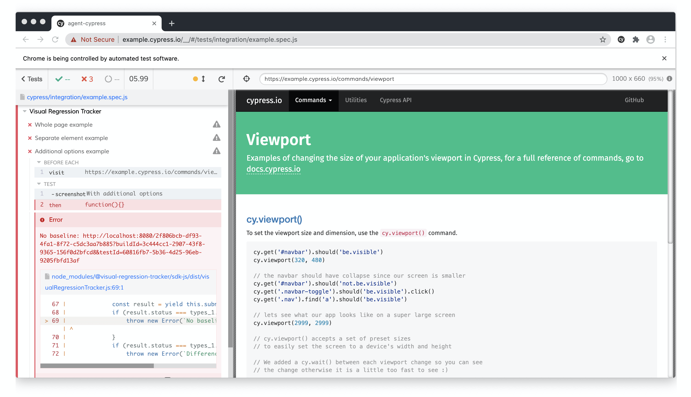
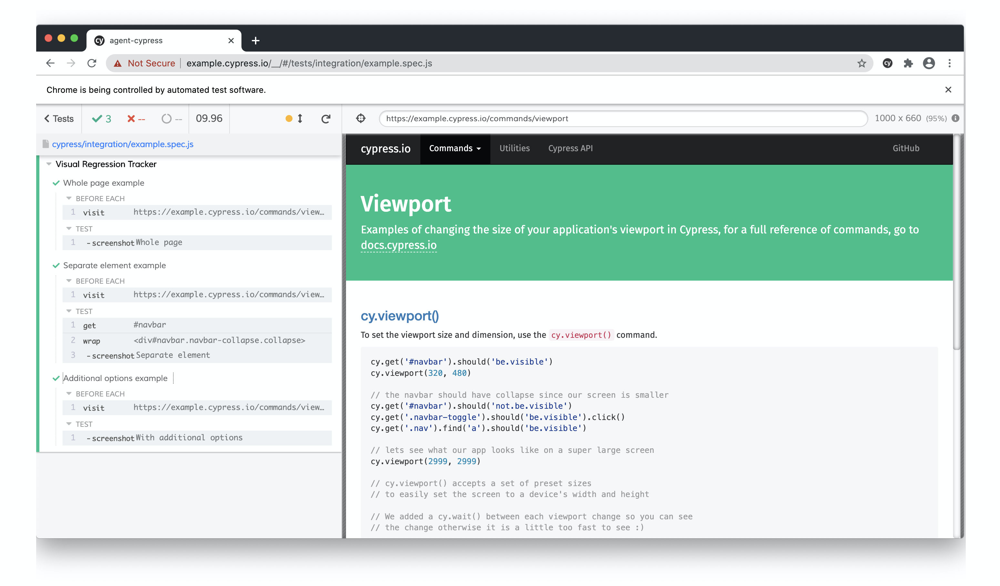
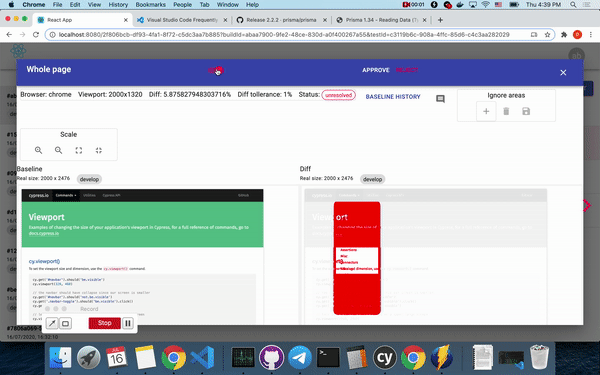
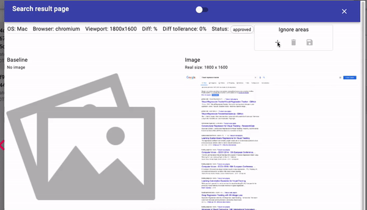

## Intro
[https://www.cypress.io/](Cypress)

Libraries used: 
* [cypress](https://www.npmjs.com/package/cypress) 
* [@visual-regression-tracker/agent-cypress](https://www.npmjs.com/package/@visual-regression-tracker/agent-cypress)

### Prerequisites 
* Visual regression tracker service is up and running. [Setup steps](https://github.com/Visual-Regression-Tracker/Visual-Regression-Tracker#set-up)

### Clone example project [Visual-Regression-Tracker/examples-js](https://github.com/Visual-Regression-Tracker/examples-js)
`$ git clone https://github.com/Visual-Regression-Tracker/examples-js.git`

`$ cd examples-js/agent-cypress`

`$ npm install`

### Update configuration
Open `cypress.json` set environment variables with your data
```json
{
  "env": {
    "visualRegressionTracker": {
      "apiUrl": "http://localhost:4200",
      "project": "Default project",
      "apiKey": "F3GCS56KVA4168HAN53YN31ASSVG",
      "branchName": "master"
    }
  }
}
```

### Add plugin
In example project it's already added

For existing projects you'll need to add command and plugin as described in [installation guide](https://www.npmjs.com/package/@visual-regression-tracker/agent-cypress#installation)

### Add assertion
Now you could add additional step in your test to validate images:
* Whole page 
```js
cy.track('Image name')
```
* Separate element
```js
cy.get('#navbar').track('Image name')
```
* With additional options

Sometimes you have the same image in different combinations of `browser`, `viewport`, `os`, `device` you could distiguish them by adding those markers for every assertion.

Viewport is taken from `Cypress.config()`

Browser is taken from `Cypress.browser.name`

```js
cy.track("With additional options", {
      os: "MacOS",
      device: "Cloud agent",
      diffTollerancePercent: 1,
})
```

### Run tests
You could run example tests by starting cypress `npx cypress open` and selecting needed suite.

As there is no baseline we expect our test to fail with the link to follow and review taken image.


### Accept baselines
Follow the link in exception and accept image if it's as you expected


### Diff found 
In case difference is greater than acceptable threshold it will be highlighted


### Ignore areas
In case image contains part that should be ignored during searching for diff we could mark them



