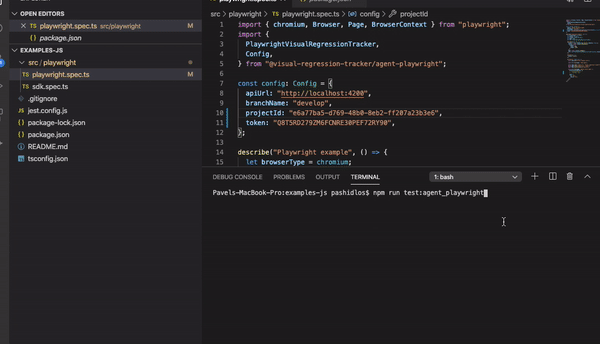
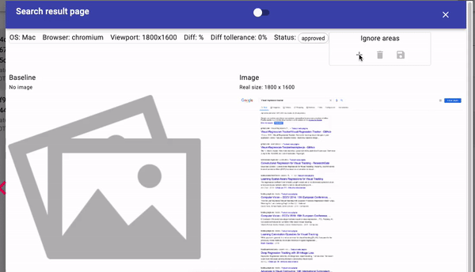

Let’s write some tests in JS with **Playwright** and **agent-playwright** library for integration with **Visual Regression Tracker**

### Test scenario
1. Open google homepage
1. Validate screenshot 
1. Search by keyword `Visual regression tracker`
1. Validate screenshot 

### Prerequisites 
* Visual regression tracker service is up and running. [Setup steps](https://github.com/Visual-Regression-Tracker/Visual-Regression-Tracker#set-up)

### Clone example project [Visual-Regression-Tracker/examples-js](https://github.com/Visual-Regression-Tracker/examples-js)
`$ git clone https://github.com/Visual-Regression-Tracker/examples-js.git`

`$ cd examples-js/agent-playwright`

`$ npm install`

### Update configuration
Open `playwright.spec.ts` and update `config` object
```
const config: Config = {
 apiUrl: "http://localhost:4200",
 branchName: "develop",
 project: "projectId",
 apiKey: "apiKey", 
};

```

### Run tests
`$ npm run test:agent_playwright `

Test failed as baseline was not found, follow by url, review image and accept it


### Accept baseline for every assertion
Repeat previous step for every assertion

Now we have all needed baselines so next time we run the test it may fail if the image is different from the baseline

### Diff found
In case difference is greater than acceptable threshold it will be highlighted


### Ignore areas
In case image contains part that should be ignored during searching for diff we could mark them
> 

### TestVariation history 
Through the time you will be replacing the baseline image with the most recent one. Still it’s possible to revisit the whole history of baseline changes 

### Image dimension mismatch
In case the page height depends on content (like google search result page) it’s likely to get different image sizes so pixel by pixel comparison would not work. Take control of this data to keep test results consistent.


### How to improve stability
* Control animation on the page - any moving part gonna bright flakiness in your tests so find the fay to control or disable it
* Handle dynamic data - don’t forget to prepare system under test for taking a screenshot by setting up needed precondition 
* Third party iframes - mark them with ignore regions or mock third party data
* Take screenshots using reproducible environment 
