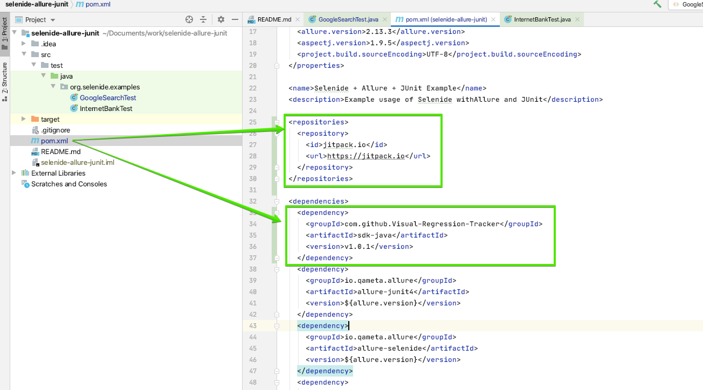
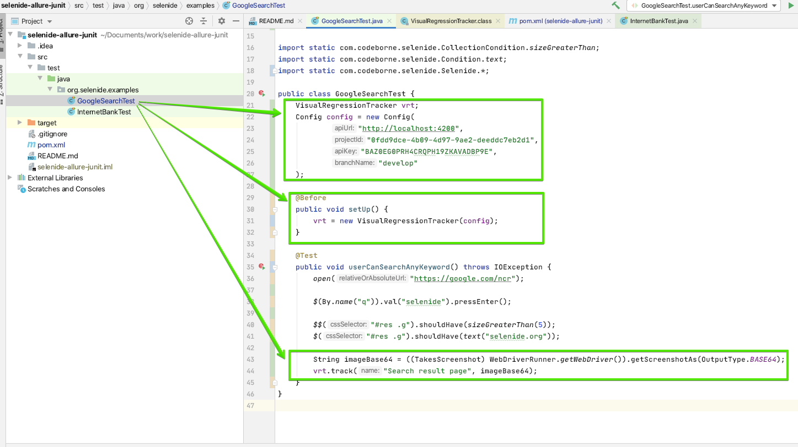
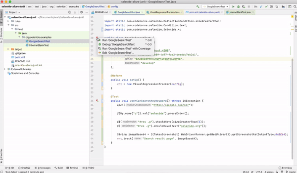
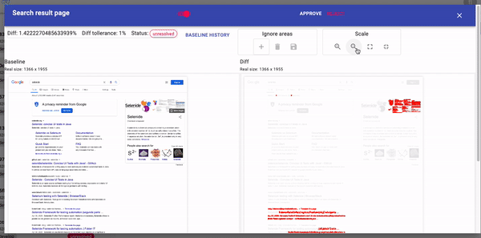
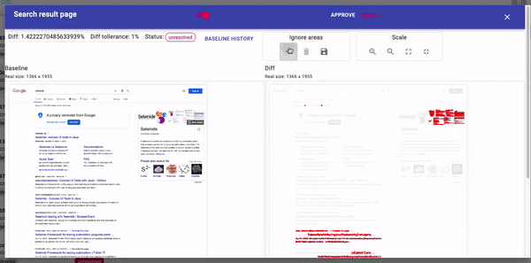

Let’s write some tests in Java with **Selenide** and **sdk-java** library for integration with **Visual Regression Tracker**

Libraries used:
* [Selenide](https://github.com/selenide/selenide)
* [Visual Regression Tracker - sdk-java](https://github.com/Visual-Regression-Tracker/sdk-java)
* [selenium-shutterbug](https://github.com/assertthat/selenium-shutterbug) 

### Prerequisites 
1. Visual regression tracker service up and running. [Setup steps](https://github.com/Visual-Regression-Tracker/Visual-Regression-Tracker#set-up)
1. Clone Selenide example project from [here](https://github.com/selenide-examples/selenide-allure-junit)

### Add maven dependency 
Open `pom.xml` and add `jitpack` repository [more info about jitpack](https://jitpack.io/)
```xml
<repositories>
    <repository>
        <id>jitpack.io</id>
        <url>https://jitpack.io</url>
    </repository>
</repositories>
```
add **sdk-java** dependency 
```xml
<dependency>
    <groupId>com.github.Visual-Regression-Tracker</groupId>
    <artifactId>sdk-java</artifactId>
    <version>${VERSION}</version>
</dependency>
```


### Configure Visual Regression Tracker and add image assertion
Open `GoogleSearchTest.java` and add configuration to establish connection with service
```java
VisualRegressionTrackerConfig config = new VisualRegressionTrackerConfig(
    // apiUrl - URL to Visual Regression Tracker backend
    "http://localhost:4200",
    
    // projectId - copy from project details 
    "003f5fcf-6c5f-4f1f-a99f-82a697711382",
    
    // apiKey - copy from user details
    "F5Z2H0H2SNMXZVHX0EA4YQM1MGDD",
    
    // branch - helps to identify version of application under test
    "develop"
);
```
Create instance of `VisualRegressionTracker` class with created config
```java
@Before
public void setUp() {
    vrt = new VisualRegressionTracker(config);
    vrt.start();
}
```
Add assertion at the end of existing test
```java
String imageBase64 = ((TakesScreenshot) WebDriverRunner.getWebDriver()).getScreenshotAs(OutputType.BASE64);
vrt.track("Search result page", imageBase64);
```


### Run test and review result
Test is failing as we don't have a baseline yet, so let's review image and `accept` or `reject` it.

### Full page screenshot 
Unfortunately using only `WebDriver` you are able to screenshot only what feats into viewport.

Fortunately there are libraries like `selenium-shutterbug` that helps to overcome this limitation.

We need to add it's dependency in `pom.xml`

```xml
<dependency>
    <groupId>com.assertthat</groupId>
    <artifactId>selenium-shutterbug</artifactId>
    <version>0.9.3</version>
    <exclusions>
        <exclusion>
	    <groupId>org.seleniumhq.selenium</groupId>
	    <artifactId>selenium-java</artifactId>
	</exclusion>
     </exclusions>
</dependency>
```

And create method that converts `BufferedImage` into Base64 encoded `String` to match `Visual Regression Tracker` format
```java
public String getWholePageScreenshot(WebDriver driver) {
     BufferedImage image = Shutterbug.shootPage(driver, ScrollStrategy.WHOLE_PAGE).getImage();
     String imageString = null;
     ByteArrayOutputStream bos = new ByteArrayOutputStream();
        try {
          ImageIO.write(image, "PNG", bos);
          byte[] imageBytes = bos.toByteArray();
          imageString = Base64.getEncoder().encodeToString(imageBytes);
          bos.close();
     } catch (IOException e) {
          e.printStackTrace();
     }
     return imageString;
}
```
As the result you will catch any change that can replace existing assertions.

### Remove randomness 
Making a screenshot of Google search result page is very unstable as its content constantly changing, that by default make it almost impossible to validate via pixel by pixel comparison.

Make sure that you are controlling the content of the page you are testing to avoid that.

In case when some regions are not important for comparison - you could exclude them:

### Diff tolerance

Diff tolerance could  be configurable for every assertion for example:

```java
vrt.track(
     "Search result page",
     image,
     TestRunOptions.builder()
          .diffTollerancePercent(2)
          .build()
);
```

### Additional options
In case you are going to make images of the same page with different combination of:
* `device`
* `OS`
* `browser`
* `viewport`

add this information to reuse the same page name:
```java
vrt.track(
     "Search result page",
     image,
     TestRunOptions.builder()
          .device("remote PC")
          .os("Linux")
          .browser("Chrome")
          .viewport("1200x1080")
          .build()
);
```