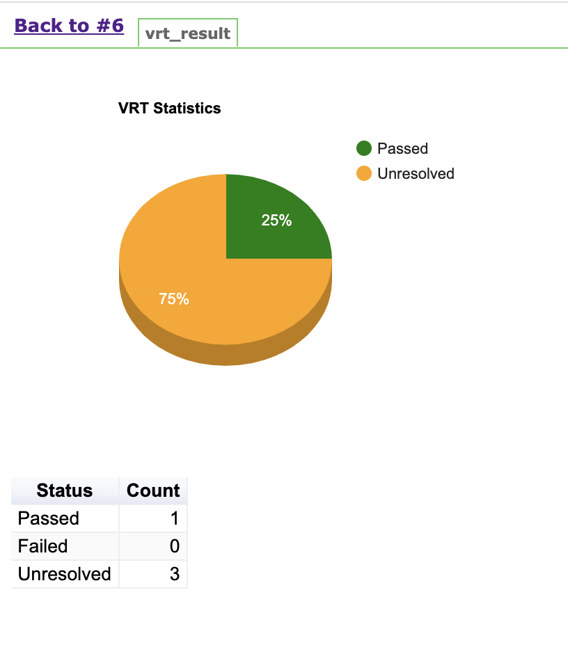
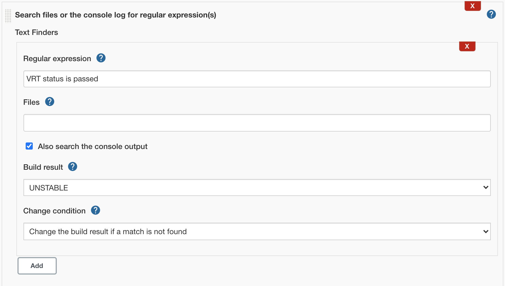
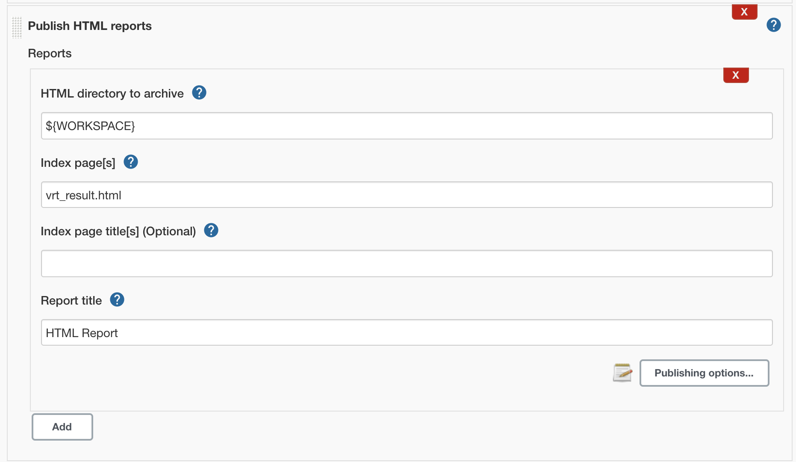
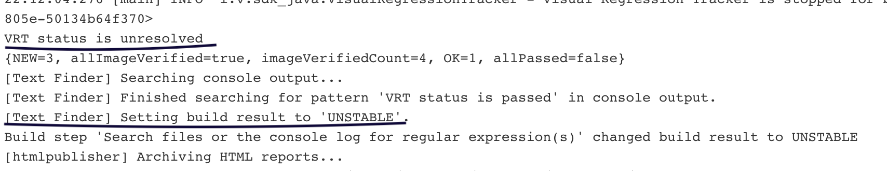

This example will explain how to configure Jenkins so that VRT results can be published. This example is specifically for tests using Java SDK as currently only this SDK provides the test run details on stopping the VRT tracking.

Libraries used:
* [Visual Regression Tracker - sdk-java (version 5.0.1 or later)](https://github.com/Visual-Regression-Tracker/sdk-java)

### Prerequisites 
1. Visual regression tracker service up and running. [Setup steps](https://github.com/Visual-Regression-Tracker/Visual-Regression-Tracker#set-up)
2. Create an example project from [here](https://github.com/Visual-Regression-Tracker/examples-java) and make sure VRT builds are running correctly.
3. JAVA 11 or later is required.

### Update code during VRT stop 
Modify your code to use below line during VRT stop.
```java
BuildResponse buildResponse = visualRegressionTracker.stop();
//Below line will create the VRT status in the log, which will check to decide if the build should be pass or not.
System.out.println("VRT status is " + buildResponse.getStatus());
writeHTMLFile(buildResponse.getPassedCount(), buildResponse.getFailedCount(), buildResponse.getUnresolvedCount());
```
The ```writeHTMLFile``` method will get the result count and will create an html file with the result that can be published in Jenkins. We are using Google chart to generate the chart in the HTML.

The method content is :
```java
    public void writeHTMLFile(int passed, int failed, int unresolved) throws IOException {
        String content = "<html>\n" +
                "  <head>\n" +
                "    <script type=\"text/javascript\" src=\"https://www.gstatic.com/charts/loader.js\"></script>\n" +
                "    <script type=\"text/javascript\">\n" +
                "     var data;\n" +
                "     var chart;\n" +
                "      google.charts.load('current', {'packages':['corechart','table']});\n" +
                "      google.charts.setOnLoadCallback(drawChart);\n" +
                "      google.charts.setOnLoadCallback(drawTable);\n" +
                "      function drawChart() {\n" +
                "        data = new google.visualization.DataTable();\n" +
                "        data.addColumn('string', 'Status');\n" +
                "        data.addColumn('number', 'Count');\n" +
                "        data.addRows([\n" +
                "          ['Passed', " + passed + "],\n" +
                "          ['Failed', " + failed + "],\n" +
                "          ['Unresolved', " + unresolved + "]\n" +
                "        ]);\n" +
                "        var options = {'title':'VRT Statistics',\n" +
                "                       'width':400,\n" +
                "                       'height':300,\n" +
                "                                                'is3D':true,\n" +
                "                                                'colors':['green','red','orange']\n" +
                "                                                };\n" +
                "        chart = new google.visualization.PieChart(document.getElementById('chart_div'));\n" +
                "        chart.draw(data, options);\n" +
                "      }\n" +
                "function drawTable() {\n" +
                "        var data = new google.visualization.DataTable();\n" +
                "        data.addColumn('string', 'Status');\n" +
                "        data.addColumn('number', 'Count');\n" +
                "        data.addRows([\n" +
                "          ['Passed',  " + passed + "],\n" +
                "          ['Failed',  " + failed + "],\n" +
                "          ['Unresolved',  " + unresolved + "]\n" +
                "        ]);\n" +
                "        var table = new google.visualization.Table(document.getElementById('table_div'));\n" +
                "        table.draw(data, {showRowNumber: false, width: 'fit-content', height: 'fit-content'});\n" +
                "      }\n" +
                "    </script>\n" +
                "  </head>\n" +
                "  <body>\n" +
                "    <span id=\"chart_div\" style=\"width:400; height:300\"></span>\n" +
                "    <span id=\"table_div\"></span>\n" +
                "  </body>\n" +
                "</html>";
        Path path = Paths.get("vrt_result.html");
        byte[] strToBytes = content.getBytes();
        Files.write(path, strToBytes);
    }
```
When the tests are run, this will create the html file with a name "vrt_result.html".

### Configure Jenkins
You can use two plugins
* [Text Finder](https://plugins.jenkins.io/text-finder/) - With this plugin, you will look for the text (***VRT status is passed***), if not found you can mark the build as unstable.
* [HTML Publisher](https://plugins.jenkins.io/htmlpublisher/) - This plugin will publish the vrt_results.html file generated as part of the test execution.  

Below screenshots will show the details configuration steps.
  




