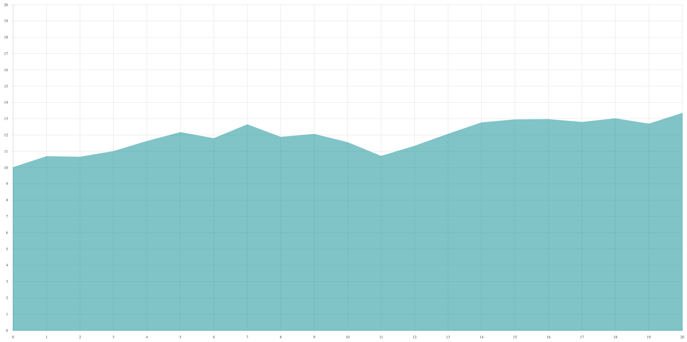
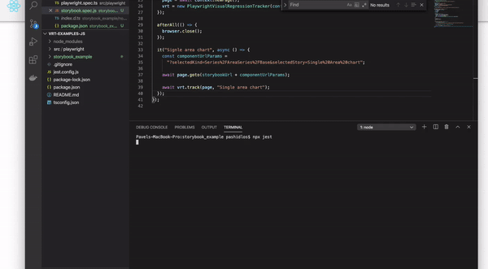
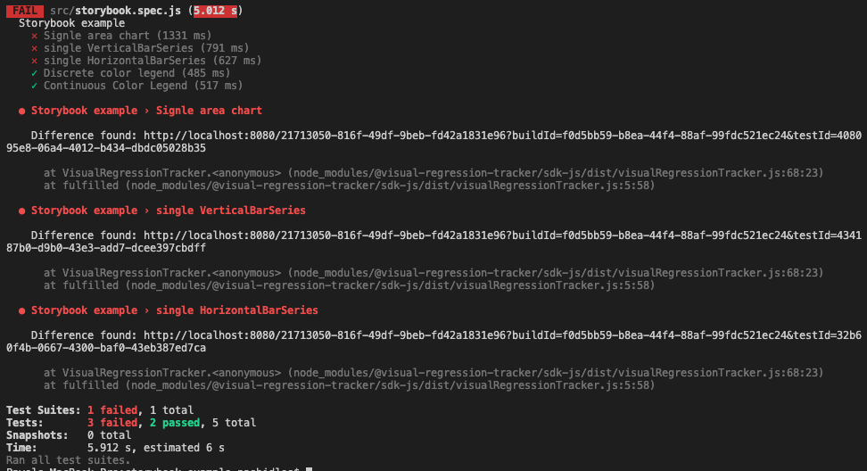
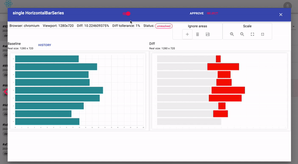
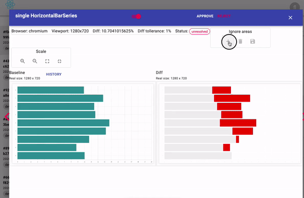
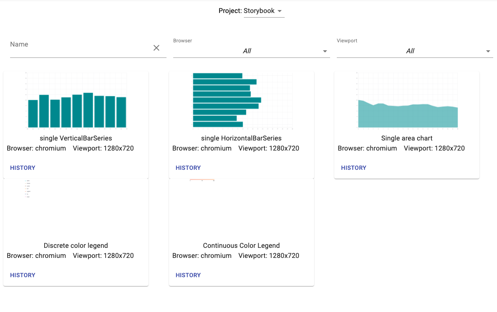

## Intro
[Storybook](https://storybook.js.org/) provide you with ability to test your frontend components in isolated environment and helps to showcase how they works and looks with different configurations. 

Here you could see some [examples](https://storybook.js.org/docs/examples/)

For learning purposes we gonna test open-source collection of react components to render common data visualization charts [React-vis](https://github.com/uber/react-vis) that has publicly open [Storybook](https://uber.github.io/react-vis/website/dist/storybook/index.html)

Libraries used: 
* [jest](https://www.npmjs.com/package/jest) 
* [playwright](https://www.npmjs.com/package/playwright) 
* [@visual-regression-tracker/agent-playwright](https://www.npmjs.com/package/@visual-regression-tracker/agent-playwright)

## Set up Visual Regression Tracker
* To have it up and running, please, follow [these steps](https://github.com/Visual-Regression-Tracker/Visual-Regression-Tracker#set-up)
* Create new project 
* Copy `apiKey` and `projectId`

## Create test project
1. Create new folder `$ mkdir storybook_example`
1. Init npm project `$ npm init`
1. Install needed dependencies `$ npm install jest playwright @visual-regression-tracker/agent-playwright`
1. Create file for test `scr/storybook.spec.js`

## Configure Visual Regression Tracker
Set up config object with your data
```
const config = {
  apiUrl: "http://localhost:4200",
  branchName: "develop",
  project: "90e3b95d-6468-4771-a2e7-7bc7d3ca2b1b",
  apiKey: "W5KJ9ZGXRV458AH1XZEJ8WF284ED",
};
``` 

## Create suite and set up preconditions
Before test suite we need to start browser and start a VRT build, as well as close the browser and stop the build after.

`PlaywrightVisualRegressionTracker` takes the browser name as a string (`browserType.name()`, e.g. `"chromium"`) and the config object, in that order.
```
const { chromium } = require("playwright");
const {
  PlaywrightVisualRegressionTracker,
} = require("@visual-regression-tracker/agent-playwright");

describe("Storybook example", () => {
  let browserType = chromium;
  let browser;
  let context;
  let page;
  let vrt;

  beforeAll(async () => {
    browser = await browserType.launch();
    context = await browser.newContext();
    page = await context.newPage();
    vrt = new PlaywrightVisualRegressionTracker(browserType.name(), config);
    await vrt.start();
  });

  afterAll(async () => {
    await browser.close();
    await vrt.stop();
  });
});

```
## Add test
Like described in [Storybook tutorial for visual testing](https://storybook.js.org/docs/testing/automated-visual-testing/) we could access needed component by providing it's parameter in url

Let's define `storybookUrl`
```
const storybookUrl = "https://uber.github.io/react-vis/website/dist/storybook/iframe.html"
```
And for every component we gonna have different url params.

Let's start with `Single Area chart`
```
const componentUrlParams = "?selectedKind=Series%2FAreaSeries%2FBase&selectedStory=Single%20Area%20chart"
```
Concatenation of those strings will load only needed component in iframe


We need navigate to that page and make assertion
```
  it("Signle area chart", async () => {
    const componentUrlParams =
      "?selectedKind=Series%2FAreaSeries%2FBase&selectedStory=Single%20Area%20chart";

    await page.goto(storybookUrl + componentUrlParams);

    await vrt.track(page, "Single area chart");
  });
```
## Run test
Let's run test for the first time and accept image as baseline 

`$ npx jest`



## Make it parametrised
To cover more component we could make test parametrised.

This will run test for every combination of `componentName` and `componentUrlParams` parameters
```
it.each([
    [
      "single VerticalBarSeries",
      "?selectedKind=Series%2FVerticalBarSeries%2FBase&selectedStory=single%20VerticalBarSeries",
    ],
    [
      "single HorizontalBarSeries",
      "?selectedKind=Series%2FHorizontalBarSeries%2FBase&selectedStory=single%20HorizontalBarSeries",
    ],
    [
      "Discrete color legend",
      "?selectedKind=Legends&selectedStory=Discrete%20color%20legend",
    ],
    [
      "Continuous Color Legend",
      "?selectedKind=Legends&selectedStory=Continuous%20Color%20Legend",
    ],
])("%s", async (componentName, componentUrlParams) => {
  await page.goto(storybookUrl + componentUrlParams);

  await vrt.track(page, componentName);
});
``` 
## Failed results
Due to randomised data in some components, every test run for them we gonna have different images and that is unacceptable for visual testing

This is what you see if difference found



## Remove randomness
It's crucial that you know what you are testing and setup system under test into needed state.

In case your image contains parts where difference not important and should be ignored during comparison - mark this as ignore area 


## List of baselines 
All accepted baselines will be used to assert next versions


## Conclusion
[Source code](https://github.com/Visual-Regression-Tracker/examples-js/tree/master/storybook)

More examples:
* [JavaScript](https://github.com/Visual-Regression-Tracker/examples-js)
* [Java](https://github.com/Visual-Regression-Tracker/examples-java)