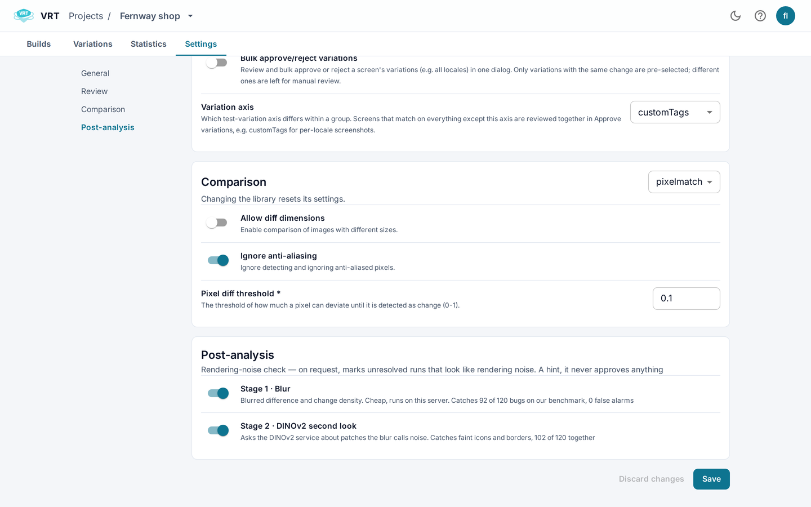

# Project settings

1. Open a project and choose the **Settings** tab.
2. Change what you need.
3. Click **Save**, or **Discard changes**.

Editors and admins only.

## General

- **Project name**
- **Main branch**: other branches are compared with it.
- **Builds to keep**: older builds are removed with their runs.
- **Max branch lifetime, days**: unused branches are cleaned up.

## Review

- **Auto approve**: see [Auto-approve](Auto-approve).
- **Bulk approve/reject variations**: review all variations of a screen in one dialog.
- **Variation axis**: which of `customTags`, `os`, `device`, `viewport`, `browser` differs in a group.

## Comparison

**Image comparison library**: `pixelmatch` (default), `lookSame`, `odiff` or `vlm`.
Changing it resets its settings.

- **pixelmatch**: **Pixel diff threshold** (0 to 1), **Ignore anti-aliasing**,
  **Allow diff dimensions**.
- **lookSame**: **Strict**, **Tolerance**, **Antialiasing tolerance**,
  **Ignore anti-aliasing**, **Ignore caret**, **Allow diff dimensions**.
- **odiff**: **Pixel diff threshold**, **Ignore anti-aliasing**, **Fail on layout diff**, **Output diff mask**.
- **vlm**: pixelmatch plus a vision model (Ollama or Gemini). Ollama address: [Configuration](Configuration).

The tolerance your tests send (`diffTollerancePercent`) still applies.

## Post-analysis

Two switches: **Stage 1 · Blur** and **Stage 2 · DINOv2 second look**.
Off for new and upgraded projects. See [Noise hint](Noise-hint).
