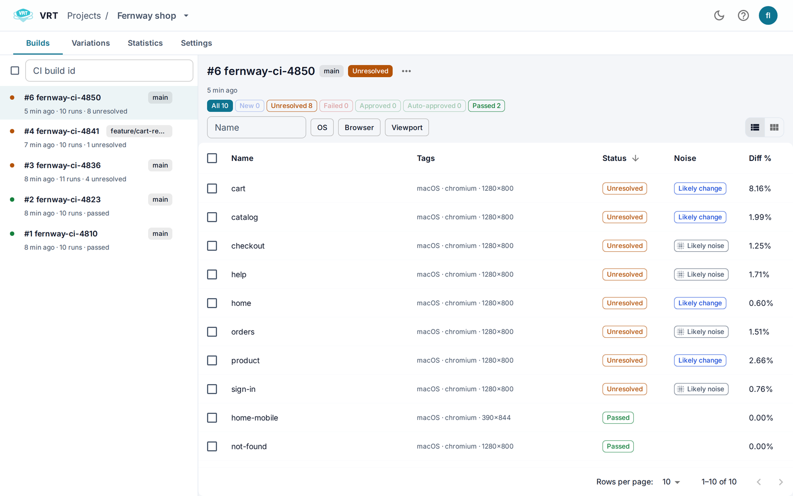

# Builds and runs

A **build** is one execution of your test suite. Each screenshot it sends is a **test run**.

## Builds

1. Open the **Builds** tab. Newest builds come first.
2. Search by CI build id.
3. Select a build to see its runs.

The header shows the number, CI build id, branch and status.
The chips count runs per status. Click one to filter. See [Statuses](Statuses).

The **Build menu** (the ⋯ button):

- **Stop build**: marks a running build as finished.
- **Analyse noise (N)**: see [Noise hint](Noise-hint).
- **Edit CI build id…**
- **Delete build…**: also removes its runs.

Select several builds to delete them together.

## Runs

- Switch between **Table view** and **Grid view**.
- Filter by OS, browser, viewport, device and tags.
- A comment icon marks runs with a comment. Hover to read it.
- Click a run to open the [Run dialog](Run-dialog).

## Bulk actions

1. Select runs with the checkboxes.
2. Pick an action in the selection bar:
   - **Approve** and **Reject**
   - **Analyse noise**: see [Noise hint](Noise-hint)
   - **Clear ignore areas…**
   - **Download zip**
   - **Delete…**

Approve and reject offer **Undo** in the message.
A run that someone else already decided is reported as failed.

## Live updates

The page updates while a build runs. You must be signed in.
