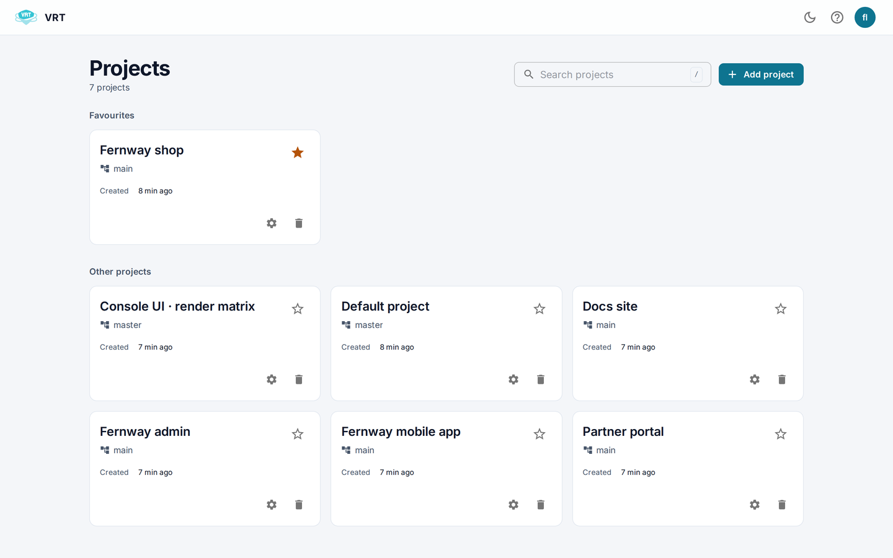

# Projects

A project holds the builds, screens and baselines of one application.

## Project list

- Cards are grouped as **Favourites** and **Other projects**.
- Search by name or main branch. Press / to jump to the search box.
- Click a card to open the project.
- Click the star to add or remove a favourite.
- **Project settings** opens [Project settings](Project-settings).
- **Delete project** removes all its builds and baselines.

Guests can see projects but not create, edit or delete them.

## Add a project

1. Click **Add project**.
2. Enter the project name and the main branch.
3. Click **Create**.

The main branch is the one other branches are compared with.

Your tests need the project id. It is in the address of the project page.
It is also in the **Configuration examples** of [Profile and API key](Profile-and-API-key).

## Switch project

Use the project menu in the breadcrumb at the top of a project page.

## Project tabs

- [Builds and runs](Builds-and-runs)
- [Variations and history](Variations-and-history)
- [Statistics](Statistics)
- [Project settings](Project-settings)
