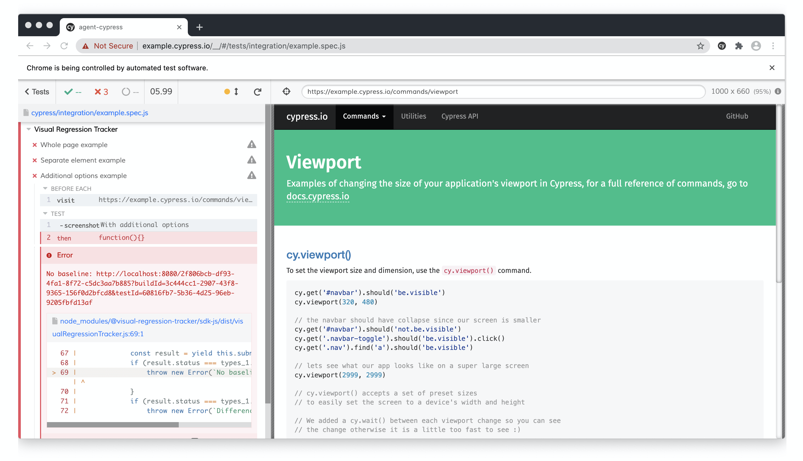
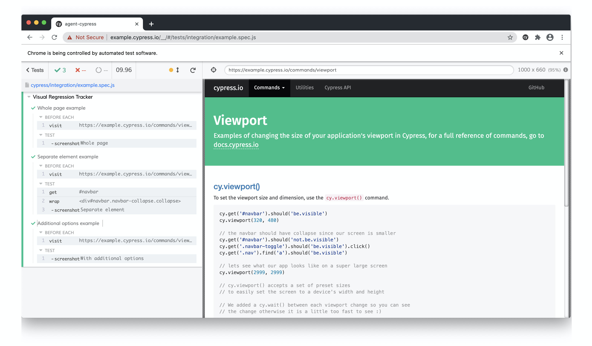
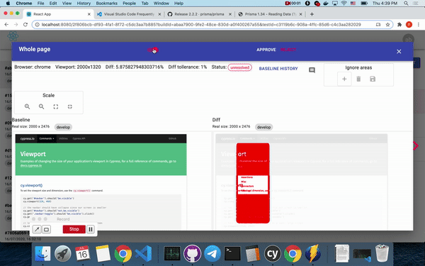
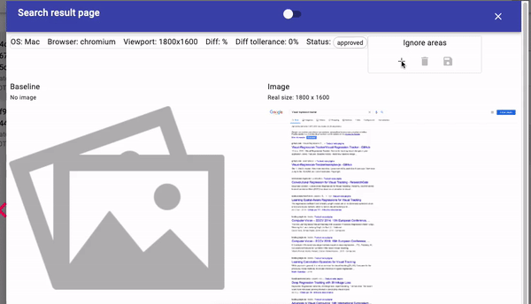

# Getting started with Cypress

Use [Cypress](https://www.cypress.io/) with [agent-cypress](https://www.npmjs.com/package/@visual-regression-tracker/agent-cypress).

## Prerequisites

VRT is running: [Getting started](Getting-started).

## Clone the example

```sh
git clone https://github.com/Visual-Regression-Tracker/examples-js.git
cd examples-js/agent-cypress
npm install
```

## Configure

Set the environment in `cypress.json`:

```json
{
  "env": {
    "visualRegressionTracker": {
      "apiUrl": "http://localhost:4200",
      "project": "Default project",
      "apiKey": "<your API key>",
      "branchName": "master"
    }
  }
}
```

The example already has the plugin. For your own project, follow the
[installation guide](https://www.npmjs.com/package/@visual-regression-tracker/agent-cypress#installation).

## Add an assertion

Whole page:

```js
cy.track('Image name')
```

One element:

```js
cy.get('#navbar').track('Image name')
```

With options, to tell apart the same image on different setups:

```js
cy.track("With additional options", {
  os: "MacOS",
  device: "Cloud agent",
  diffTollerancePercent: 1,
})
```

Viewport comes from `Cypress.config()`, browser from `Cypress.browser.name`.

## Run

1. Run `npx cypress open` and pick a suite.
2. The test fails with a link: there is no baseline yet.



## Approve baselines

Open the link and approve the image.



## Diff found

A difference above the tolerance is highlighted.



## Ignore areas

Mark parts of the image to leave out of the comparison.


