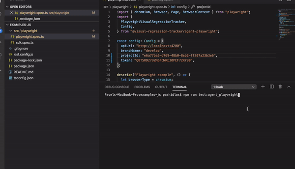
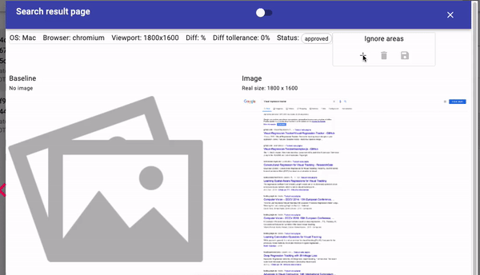

# Getting started with Playwright

Write a test in JS with **Playwright** and **agent-playwright**.

Scenario:

1. Open the Google homepage and check the screenshot.
2. Search for `Visual regression tracker` and check the screenshot.

## Prerequisites

VRT is running: [Getting started](Getting-started).

## Clone the example

```sh
git clone https://github.com/Visual-Regression-Tracker/examples-js.git
cd examples-js/agent-playwright
npm install
```

## Configure

Edit the `config` object in `playwright.spec.ts`:

```ts
const config: Config = {
  apiUrl: "http://localhost:4200",
  branchName: "develop",
  project: "projectId",
  apiKey: "apiKey",
};
```

## Run

1. `npm run test:agent_playwright`
2. The test fails: there is no baseline yet.
3. Open the link, review the image and approve it.



Approve a baseline for every assertion. Later runs fail if the image differs.

## Diff found

A difference above the tolerance is highlighted in the [Run dialog](Run-dialog).

## Ignore areas

Mark parts of the image to leave out of the comparison.



## History

Every baseline change is kept: [Variations and history](Variations-and-history).

## Image size mismatch

Pages with variable height give different image sizes. Control the content to keep results stable.

## Stability tips

- Disable or control animations.
- Prepare dynamic data before the screenshot.
- Mark third-party iframes as ignore areas, or mock them.
- Take screenshots in a reproducible environment.
