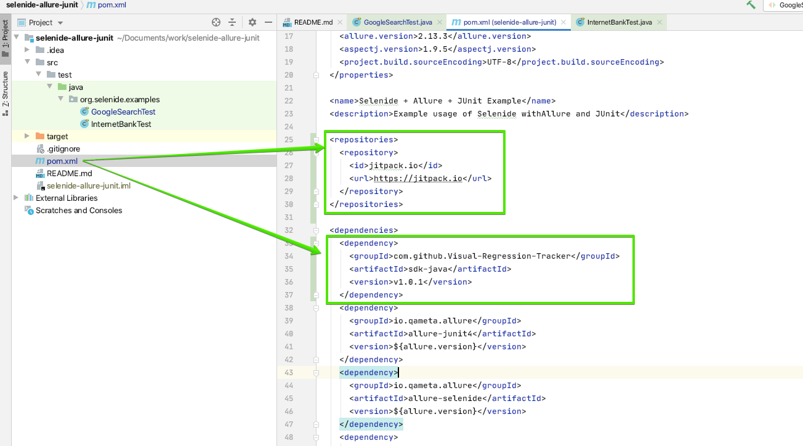
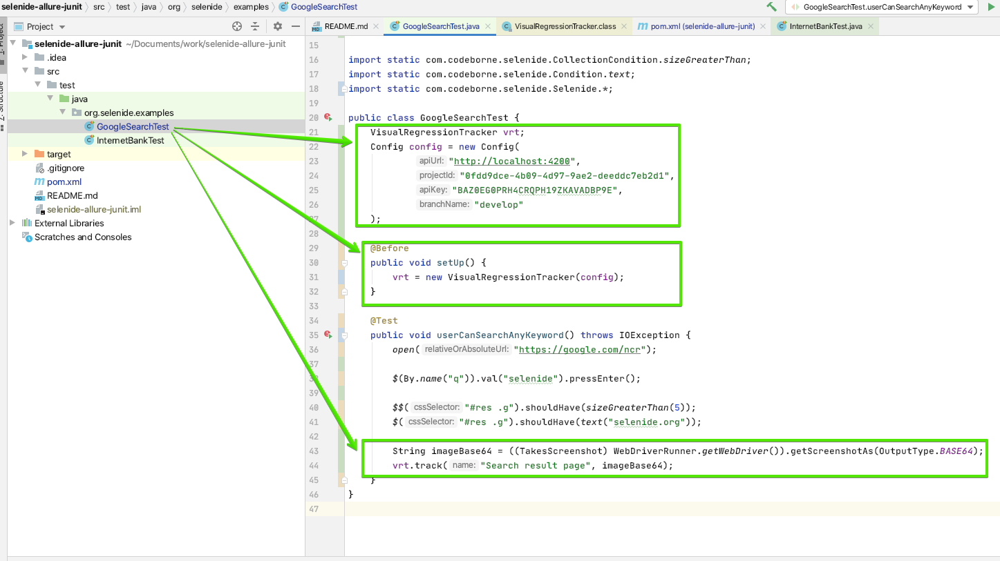
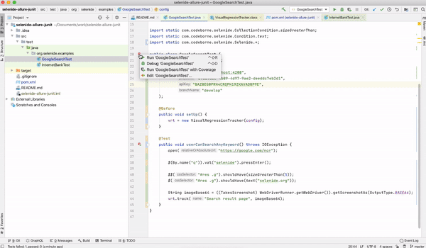
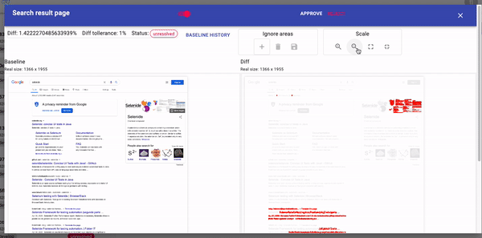
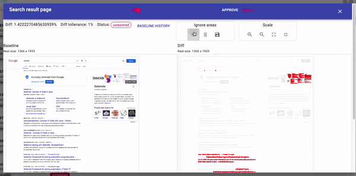

# Getting started with Selenide

Write a test in Java with **Selenide** and **sdk-java**.

Libraries:

- [Selenide](https://github.com/selenide/selenide)
- [sdk-java](https://github.com/Visual-Regression-Tracker/sdk-java)
- [selenium-shutterbug](https://github.com/assertthat/selenium-shutterbug)

## Prerequisites

1. VRT is running: [Getting started](Getting-started).
2. Clone the [Selenide example project](https://github.com/selenide-examples/selenide-allure-junit).

## Add the dependency

1. In `pom.xml`, add the [jitpack](https://jitpack.io/) repository:

   ```xml
   <repositories>
       <repository>
           <id>jitpack.io</id>
           <url>https://jitpack.io</url>
       </repository>
   </repositories>
   ```

2. Add **sdk-java**:

   ```xml
   <dependency>
       <groupId>com.github.Visual-Regression-Tracker</groupId>
       <artifactId>sdk-java</artifactId>
       <version>${VERSION}</version>
   </dependency>
   ```



## Configure and add an assertion

1. In `GoogleSearchTest.java`, create the config:

   ```java
   VisualRegressionTrackerConfig config = new VisualRegressionTrackerConfig(
       "http://localhost:4200",                 // API URL
       "003f5fcf-6c5f-4f1f-a99f-82a697711382",  // project id
       "<your API key>",                        // API key from your profile
       "develop"                                // branch
   );
   ```

2. Create the tracker:

   ```java
   @Before
   public void setUp() {
       vrt = new VisualRegressionTracker(config);
       vrt.start();
   }
   ```

3. Add the assertion at the end of a test:

   ```java
   String imageBase64 = ((TakesScreenshot) WebDriverRunner.getWebDriver()).getScreenshotAs(OutputType.BASE64);
   vrt.track("Search result page", imageBase64);
   ```



## Run and review

1. Run the test. It fails: there is no baseline yet.
2. Review the image and approve it.



## Full page screenshot

`WebDriver` captures only the viewport. Use `selenium-shutterbug` for the whole page.

1. Add the dependency:

   ```xml
   <dependency>
       <groupId>com.assertthat</groupId>
       <artifactId>selenium-shutterbug</artifactId>
       <version>0.9.3</version>
       <exclusions>
           <exclusion>
               <groupId>org.seleniumhq.selenium</groupId>
               <artifactId>selenium-java</artifactId>
           </exclusion>
       </exclusions>
   </dependency>
   ```

2. Convert the image to Base64:

   ```java
   public String getWholePageScreenshot(WebDriver driver) throws IOException {
       BufferedImage image = Shutterbug.shootPage(driver, ScrollStrategy.WHOLE_PAGE).getImage();
       ByteArrayOutputStream bos = new ByteArrayOutputStream();
       ImageIO.write(image, "PNG", bos);
       return Base64.getEncoder().encodeToString(bos.toByteArray());
   }
   ```



## Remove randomness

- Control the content of the page you test.
- Exclude unimportant regions with ignore areas.



## Diff tolerance

Set it per assertion:

```java
vrt.track(
    "Search result page",
    image,
    TestRunOptions.builder()
        .diffTollerancePercent(2)
        .build()
);
```

## Additional options

Track the same page on different `device`, `OS`, `browser` or `viewport`:

```java
vrt.track(
    "Search result page",
    image,
    TestRunOptions.builder()
        .device("remote PC")
        .os("Linux")
        .browser("Chrome")
        .viewport("1200x1080")
        .build()
);
```
