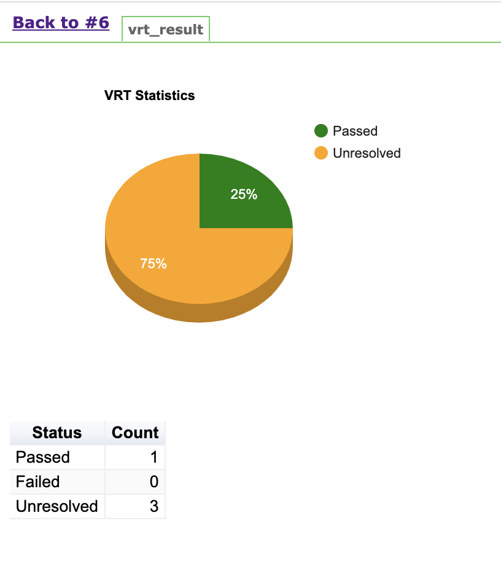
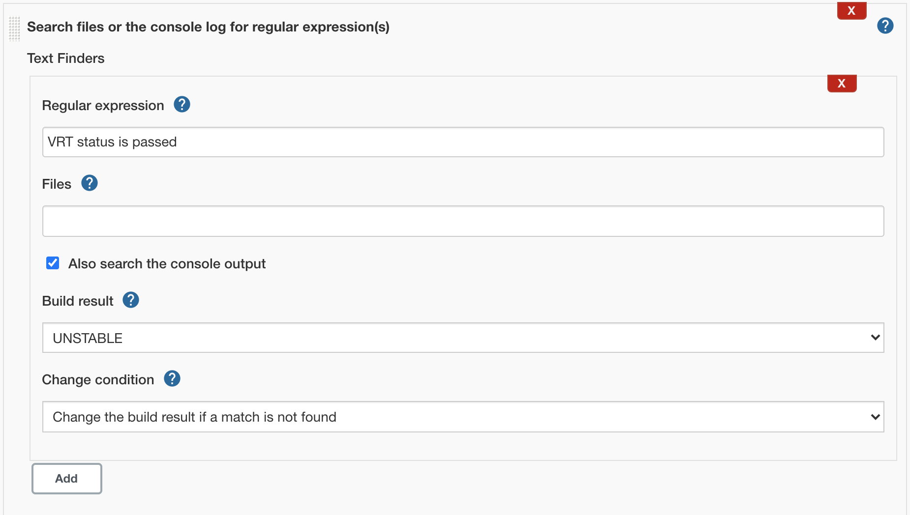
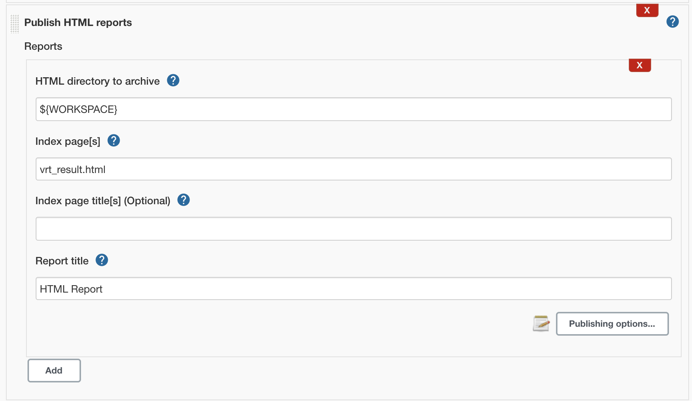
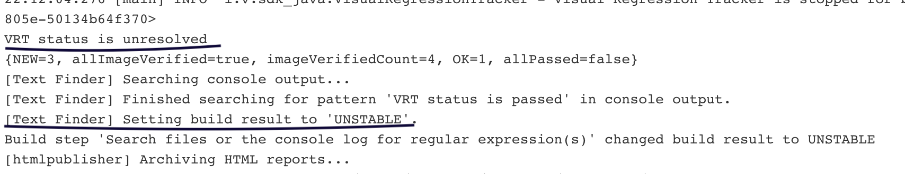

# How to publish VRT result in Jenkins

Show VRT results in Jenkins and mark the build unstable on failures.
Only the Java SDK returns the run counts when tracking stops.

Needs [sdk-java](https://github.com/Visual-Regression-Tracker/sdk-java) 5.0.1 or later and Java 11 or later.

## Prerequisites

1. VRT is running: [Getting started](Getting-started).
2. The [Java example](https://github.com/Visual-Regression-Tracker/examples-java) runs correctly.

## Change the code

1. Replace the stop call:

   ```java
   BuildResponse buildResponse = visualRegressionTracker.stop();
   System.out.println("VRT status is " + buildResponse.getStatus());
   writeHTMLFile(buildResponse.getPassedCount(), buildResponse.getFailedCount(), buildResponse.getUnresolvedCount());
   ```

2. Add `writeHTMLFile`. It writes `vrt_result.html` with a Google chart:

   ```java
       public void writeHTMLFile(int passed, int failed, int unresolved) throws IOException {
           String content = "<html>\n" +
                   "  <head>\n" +
                   "    <script type=\"text/javascript\" src=\"https://www.gstatic.com/charts/loader.js\"></script>\n" +
                   "    <script type=\"text/javascript\">\n" +
                   "     var data;\n" +
                   "     var chart;\n" +
                   "      google.charts.load('current', {'packages':['corechart','table']});\n" +
                   "      google.charts.setOnLoadCallback(drawChart);\n" +
                   "      google.charts.setOnLoadCallback(drawTable);\n" +
                   "      function drawChart() {\n" +
                   "        data = new google.visualization.DataTable();\n" +
                   "        data.addColumn('string', 'Status');\n" +
                   "        data.addColumn('number', 'Count');\n" +
                   "        data.addRows([\n" +
                   "          ['Passed', " + passed + "],\n" +
                   "          ['Failed', " + failed + "],\n" +
                   "          ['Unresolved', " + unresolved + "]\n" +
                   "        ]);\n" +
                   "        var options = {'title':'VRT Statistics',\n" +
                   "                       'width':400,\n" +
                   "                       'height':300,\n" +
                   "                                                'is3D':true,\n" +
                   "                                                'colors':['green','red','orange']\n" +
                   "                                                };\n" +
                   "        chart = new google.visualization.PieChart(document.getElementById('chart_div'));\n" +
                   "        chart.draw(data, options);\n" +
                   "      }\n" +
                   "function drawTable() {\n" +
                   "        var data = new google.visualization.DataTable();\n" +
                   "        data.addColumn('string', 'Status');\n" +
                   "        data.addColumn('number', 'Count');\n" +
                   "        data.addRows([\n" +
                   "          ['Passed',  " + passed + "],\n" +
                   "          ['Failed',  " + failed + "],\n" +
                   "          ['Unresolved',  " + unresolved + "]\n" +
                   "        ]);\n" +
                   "        var table = new google.visualization.Table(document.getElementById('table_div'));\n" +
                   "        table.draw(data, {showRowNumber: false, width: 'fit-content', height: 'fit-content'});\n" +
                   "      }\n" +
                   "    </script>\n" +
                   "  </head>\n" +
                   "  <body>\n" +
                   "    <span id=\"chart_div\" style=\"width:400; height:300\"></span>\n" +
                   "    <span id=\"table_div\"></span>\n" +
                   "  </body>\n" +
                   "</html>";
           Path path = Paths.get("vrt_result.html");
           byte[] strToBytes = content.getBytes();
           Files.write(path, strToBytes);
       }
   ```

## Configure Jenkins

1. Install [Text Finder](https://plugins.jenkins.io/text-finder/).
   Search for `VRT status is passed` and mark the build unstable if not found.
2. Install [HTML Publisher](https://plugins.jenkins.io/htmlpublisher/).
   Publish `vrt_result.html`.





