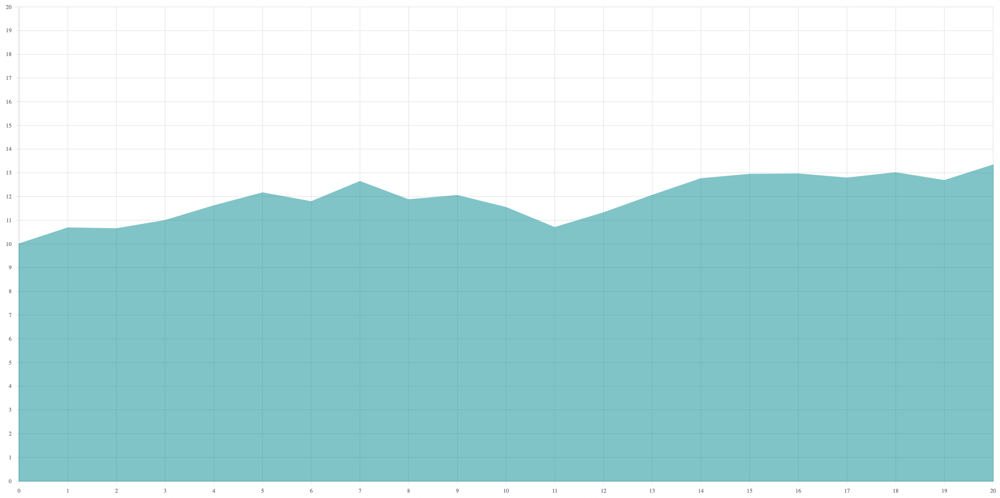
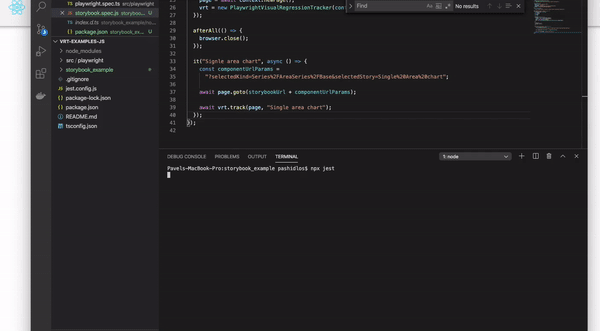
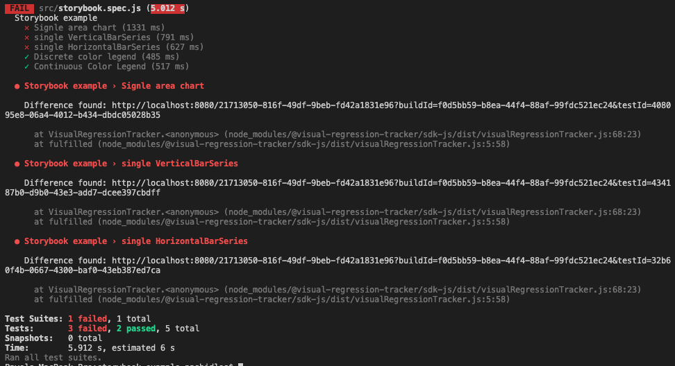
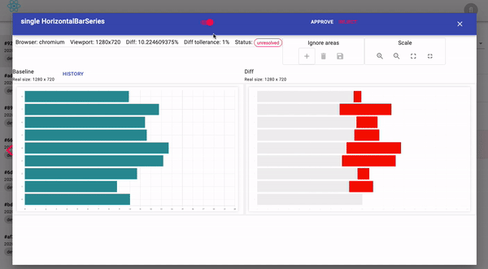
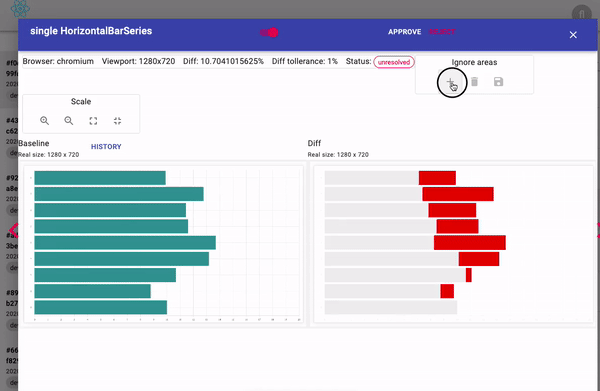
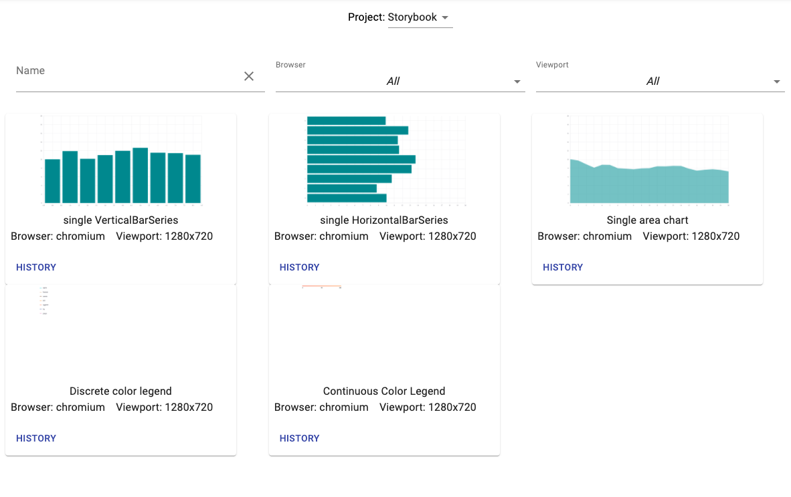

# Storybook

Test components of a [Storybook](https://storybook.js.org/) with jest, playwright and agent-playwright.

The example tests the public Storybook of [React-vis](https://github.com/uber/react-vis).

Libraries:

- [jest](https://www.npmjs.com/package/jest)
- [playwright](https://www.npmjs.com/package/playwright)
- [@visual-regression-tracker/agent-playwright](https://www.npmjs.com/package/@visual-regression-tracker/agent-playwright)

## Set up VRT

1. Start VRT: [Getting started](Getting-started).
2. Create a project.
3. Copy the `apiKey` and the `projectId`.

## Create the test project

1. `mkdir storybook_example && cd storybook_example`
2. `npm init`
3. `npm install jest playwright @visual-regression-tracker/agent-playwright`
4. Create `scr/storybook.spec.js`.

## Configure

```js
const config = {
  apiUrl: "http://localhost:4200",
  branchName: "develop",
  project: "<project id>",
  apiKey: "<your API key>",
};
```

## Set up the suite

Start the browser and a VRT build before the suite. Close both after it.
The agent takes the browser name and the config, in that order.

```js
const { chromium } = require("playwright");
const {
  PlaywrightVisualRegressionTracker,
} = require("@visual-regression-tracker/agent-playwright");

describe("Storybook example", () => {
  let browserType = chromium;
  let browser;
  let context;
  let page;
  let vrt;

  beforeAll(async () => {
    browser = await browserType.launch();
    context = await browser.newContext();
    page = await context.newPage();
    vrt = new PlaywrightVisualRegressionTracker(browserType.name(), config);
    await vrt.start();
  });

  afterAll(async () => {
    await browser.close();
    await vrt.stop();
  });
});
```

## Add a test

Load one component in the iframe by URL, as in the
[Storybook guide](https://storybook.js.org/docs/testing/automated-visual-testing/).

1. Define the base URL:

   ```js
   const storybookUrl = "https://uber.github.io/react-vis/website/dist/storybook/iframe.html"
   ```

2. Add the test for one component:

   ```js
   it("Single area chart", async () => {
     const componentUrlParams =
       "?selectedKind=Series%2FAreaSeries%2FBase&selectedStory=Single%20Area%20chart";

     await page.goto(storybookUrl + componentUrlParams);

     await vrt.track(page, "Single area chart");
   });
   ```



## Run

1. `npx jest`
2. Review the image in VRT and approve it as the baseline.



## Many components

`it.each` runs the test once per component:

```js
it.each([
  [
    "single VerticalBarSeries",
    "?selectedKind=Series%2FVerticalBarSeries%2FBase&selectedStory=single%20VerticalBarSeries",
  ],
  [
    "single HorizontalBarSeries",
    "?selectedKind=Series%2FHorizontalBarSeries%2FBase&selectedStory=single%20HorizontalBarSeries",
  ],
  [
    "Discrete color legend",
    "?selectedKind=Legends&selectedStory=Discrete%20color%20legend",
  ],
  [
    "Continuous Color Legend",
    "?selectedKind=Legends&selectedStory=Continuous%20Color%20Legend",
  ],
])("%s", async (componentName, componentUrlParams) => {
  await page.goto(storybookUrl + componentUrlParams);

  await vrt.track(page, componentName);
});
```

## Failed results

Random data in some components gives a different image on every run. This is what a difference looks like:




## Remove randomness

- Put the system under test into a known state.
- Mark unimportant parts as ignore areas.



## Baselines

Accepted baselines are used for the next runs.



## More

- [Source code](https://github.com/Visual-Regression-Tracker/examples-js/tree/master/storybook)
- [JavaScript examples](https://github.com/Visual-Regression-Tracker/examples-js)
- [Java examples](https://github.com/Visual-Regression-Tracker/examples-java)
