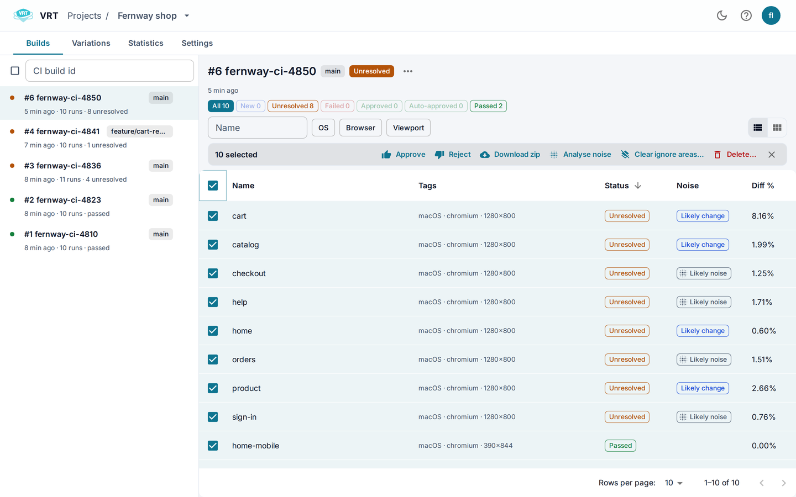

# Noise hint

Machines draw pages a little differently. That noise buries real changes.
The noise hint (post-analysis) labels unresolved runs, so you review likely changes first.

## What it does

- Labels a run **Likely change** or **Likely noise**, with a score.
- Never changes a status. Never approves or rejects.
- Does not trigger [Auto-approve](Auto-approve).
- Can call a tiny change noise, such as one digit. Check the diff.
- Runs only when you ask, on unresolved runs.

## Turn it on

It is off by default. Not available for projects that use the VLM library.

1. Open the project's **Settings** tab, section **Post-analysis**.
2. Turn on **Stage 1 · Blur**. It needs nothing else.
3. Optional: turn on **Stage 2 · DINOv2 second look**. It needs `DINOV2_URL`, see [Configuration](Configuration).
4. Click **Save**.

See also [Project settings](Project-settings).

## Analyse

- **Whole build:** Build menu, **Analyse noise (N)**.
- **Selected runs:** select runs, click **Analyse noise**.
- **One run:** click the noise chip in the [Run dialog](Run-dialog), then **Analyse**.

Use **Analyse again** to repeat. The build header shows progress.

## Read the result

- The run list has a **Noise** column. Hover for the score.
- In the run dialog, click the chip for details.
- **Can't tell** means no verdict, for example when image sizes differ.
