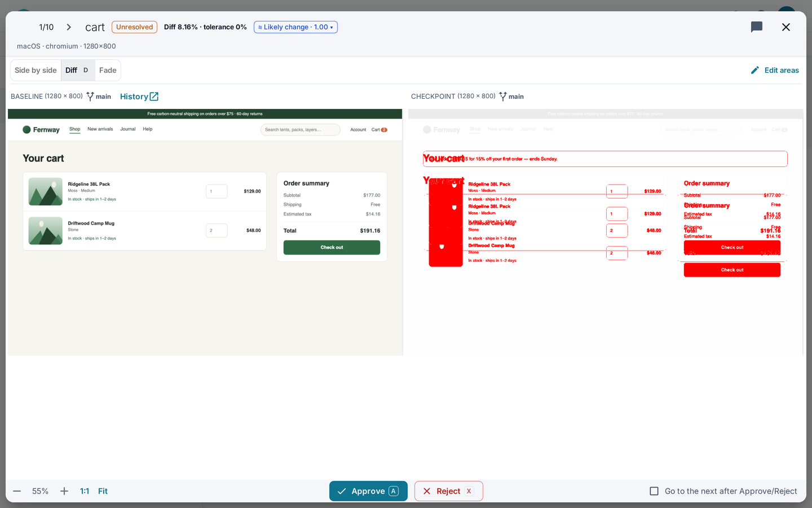
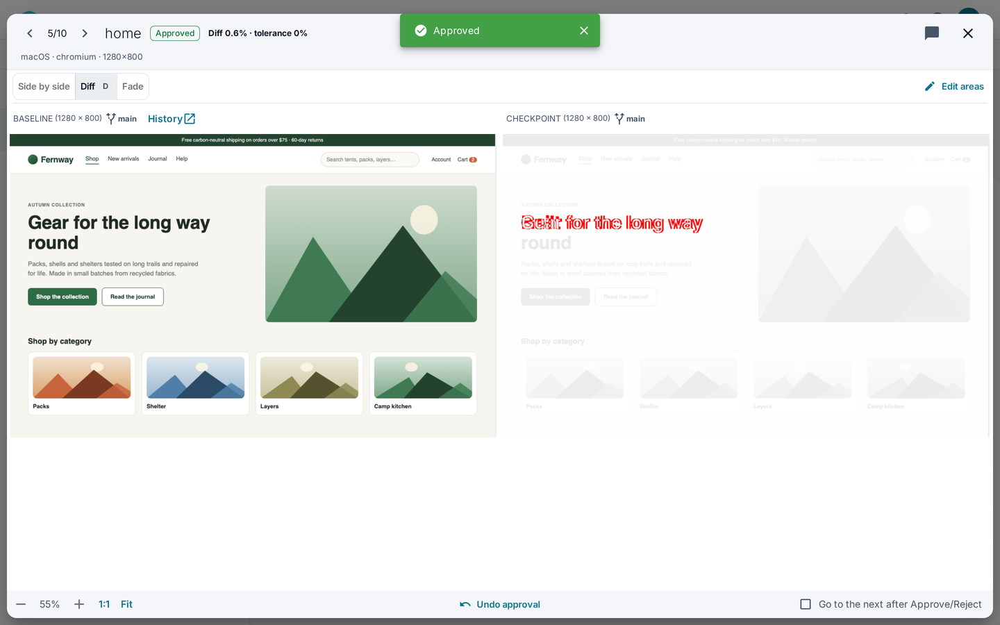

# Run dialog

Click a run to open it. Compare the baseline with the new screenshot, then approve or reject.

## Header

- **Previous run** and **Next run** (arrow keys).
- Status and diff, for example "Diff 0.4% · tolerance 0.1%".
- Noise chip, if enabled: [Noise hint](Noise-hint).
- **Add comment**, or click the comment chip to edit it.
- **Close**.

A message appears above the images if one fails to load or the sizes differ.

## View modes

| Mode | Shows |
|---|---|
| **Side by side** | Baseline and new screenshot together. |
| **Diff** | Changed pixels highlighted (hotkey D). |
| **Fade** | New screenshot faded over the baseline. |

Zoom with **Zoom in**, **Zoom out**, **Fit into screen** and **Original size**.

## Ignore areas

Leave out parts that change on their own, such as dates or ads.

1. Click **Edit areas**.
2. Pick **Ignore areas** or **Compare area**.
3. Click **Draw** and drag on the image.
4. Click **Save**.

- **Delete selected** and **Clear all** remove areas.
- **Apply selected to whole build…** re-compares the build with the area.
- The **Ignore areas (N)** chip shows or hides the saved areas.
- Areas belong to the screen, so later runs use them too.

## Approve, reject and Undo

- **Approve** (hotkey A) and **Reject** (hotkey X) are in the footer.
- **Go to the next after Approve/Reject** moves on automatically.
- A merge run shows "merge into: <branch>". Approving updates that branch.
- **Approve variations…** and **Reject variations…** act on all matching variations.
  Turn it on in [Project settings](Project-settings).

To undo:

1. Click **Undo** in the message, or **Undo approval** / **Undo rejection** in the footer.
2. The run returns to its earlier status.

- Undoing an approval also restores ignore areas and comment.
- Approvals made before 6.0 restore neither.
- Auto-approved runs cannot be undone.
